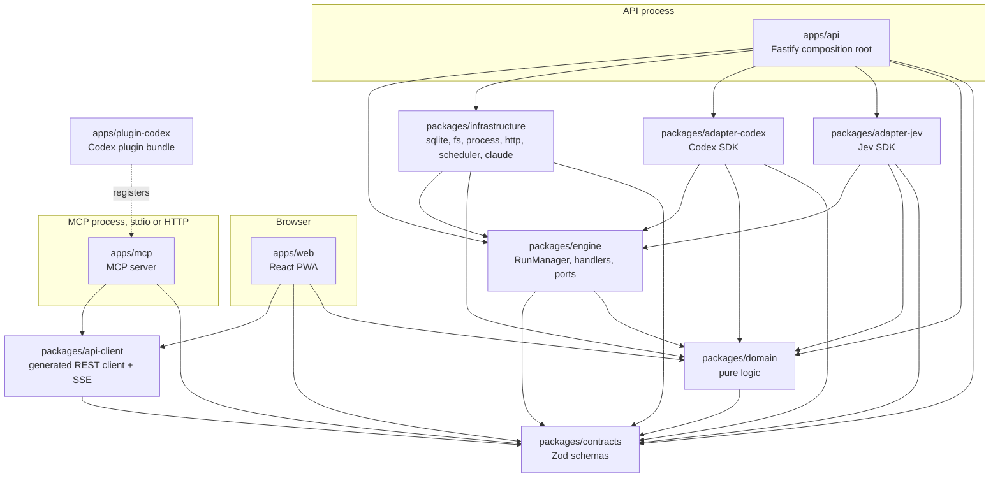
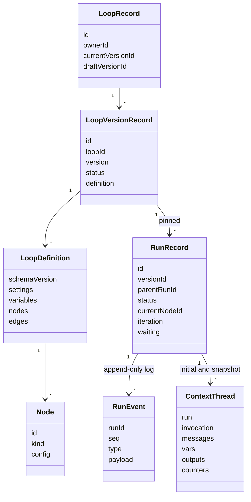
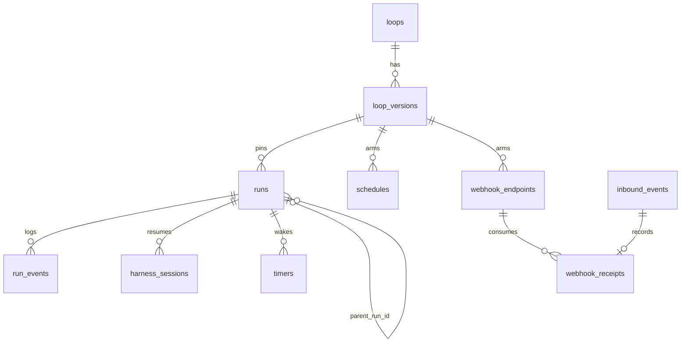
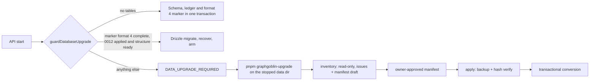
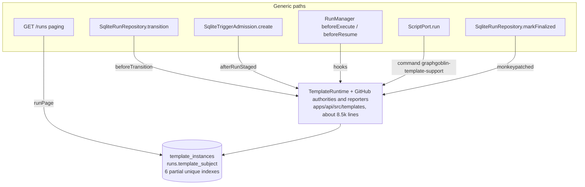
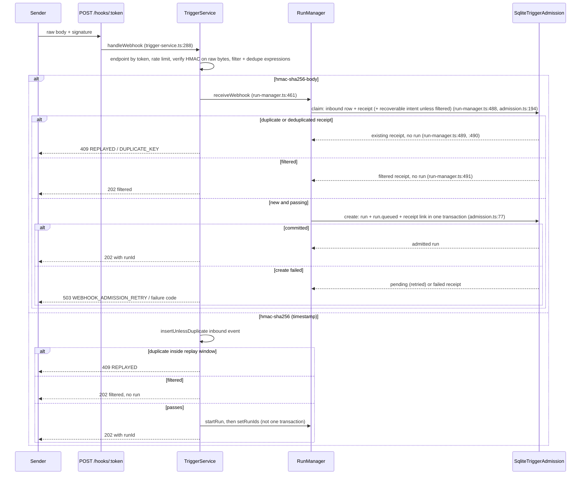

# Architecture snapshot

Snapshot of `main` at commit `c379f80` (2026-10-12), written for issue #163. Every `path:line` reference points at that commit. The numbered documents (02 to 11) describe the intended design; this page describes what the code does today, including the parts that #164, #165 and #168 will change. The companion [debt register](debt-register.md) lists the problems found and the recommended follow-ups.

Evidence labels used here and in the register: **Observed** means a command or test was run for this report; **Risk** means it was read from the code; **Hypothesis** means it is unverified.

## 1. Packages, layers and composition roots



| Package                   | Selected production dependencies (from each `package.json`)                         | Role                                                                                                                                                                   |
| ------------------------- | ----------------------------------------------------------------------------------- | ---------------------------------------------------------------------------------------------------------------------------------------------------------------------- |
| `packages/contracts`      | `zod`                                                                               | Schemas and types for loops, nodes, threads, runs, events, API DTOs; entry `packages/contracts/src/index.ts:7` declares `CONTRACTS_SCHEMA_VERSION = 3`                 |
| `packages/domain`         | contracts, `ajv`, `jsonata`, `liquidjs`                                             | Graph validation (`packages/domain/src/graph.ts:79`), replay (`packages/domain/src/replay.ts:25`), expressions, exit matching, frozen upgrade stages                   |
| `packages/engine`         | contracts, domain                                                                   | `RunManager` (`packages/engine/src/run-manager.ts:284`), node handlers (`packages/engine/src/handlers/index.ts:12`), ports (`packages/engine/src/ports.ts:429`), fakes |
| `packages/infrastructure` | contracts, domain, engine, `@libsql/client`, `croner`, `drizzle-orm`                | Folders `src/sqlite`, `src/fs`, `src/process`, `src/http`, `src/scheduler` and `src/claude` (the Claude Code harness, which spawns the installed CLI)                  |
| `packages/adapter-codex`  | contracts, domain, engine, `@openai/codex-sdk`                                      | Codex harness, structured completion and the LLM decider                                                                                                               |
| `packages/adapter-jev`    | contracts, domain, engine, `@typesafe-ai/sdk`                                       | Jev classifier (`packages/adapter-jev/src/decider.ts:128`)                                                                                                             |
| `packages/api-client`     | contracts, `openapi-fetch`                                                          | Typed REST client generated from the OpenAPI document, SSE subscription (`packages/api-client/src/sse.ts:159`)                                                         |
| `apps/api`                | everything above except api-client, plus Fastify                                    | Composition root: builds every port in `apps/api/src/container.ts:178`, registers routes in `apps/api/src/app.ts:84`                                                   |
| `apps/mcp`                | api-client, contracts, `@modelcontextprotocol/sdk`                                  | MCP tools over the REST client (`apps/mcp/src/tools.ts:107`): list/describe loops, start, wait, inspect, replay, input, signal                                         |
| `apps/web`                | api-client, contracts, domain, React, TanStack Query, Zustand, xyflow, `idb-keyval` | Editor, run inspector, settings, PWA                                                                                                                                   |
| `apps/plugin-codex`       | `zod`                                                                               | Assembles the Codex plugin: MCP registration plus skills (`apps/plugin-codex/src/assemble.ts:69`)                                                                      |

Layer direction is enforced by `pnpm check:layers` and dependency-cruiser (AGENTS.md). Each package exposes a `development` export condition pointing at TypeScript source, so tests and lint never need `dist/` (`packages/contracts/package.json:9`). The engine composition root is `apps/api`: `createContainer` opens the database, wires every engine port and the draft catalogue, and returns `start`/`stop` (`apps/api/src/container.ts:178`). The web app is a client of its REST API; the MCP server runs as its own process with a stdio or Streamable HTTP entry (`apps/mcp/src/main.ts:35`, `apps/mcp/src/main.ts:67`, `apps/mcp/src/main.ts:73`) calling the same API; the Codex plugin registers it.

Note on placement: the Claude Code harness lives in `packages/infrastructure/src/claude` rather than an `adapter-claude` package, because it has no npm dependency (it spawns the user-installed CLI, ADR-0023). `docs/02-architecture.md:16` and `docs/02-architecture.md:76` still describe Codex as the only harness; see register item D26.

## 2. Contracts and data models



- **Loop definition**: `packages/contracts/src/loop.ts:50`. `schemaVersion` is the literal `3` (`packages/contracts/src/loop.ts:51`); the export file wraps it with `formatVersion: 3` (`packages/contracts/src/loop.ts:65`).
- **Node kinds**: trigger, decision, inference, script, mutate, subloop, wait, heartbeat, exit (`packages/contracts/src/nodes.ts:36`). Trigger configs are a union keyed by `subtype`: manual, cron, two webhook variants, event, poll (`packages/contracts/src/nodes.ts:92`). Exit configs carry ordered criteria and an optional loop-back (`packages/contracts/src/nodes.ts:763`, `packages/contracts/src/nodes.ts:774`).
- **Evaluation** (decisions and exit predicates): answer specs Choice, Noul and Score (`packages/contracts/src/evaluation.ts:193`) combined with an evaluator union of expression, classifier and LLM (`packages/contracts/src/evaluation.ts:290`, `packages/contracts/src/evaluation.ts:322`). This combination is what #164 splits.
- **Context thread**: the shared state every node reads and patches with RFC 6902 JSON Patch (`packages/contracts/src/thread.ts:129`).
- **Runs**: eight statuses, four terminal (`packages/contracts/src/run.ts:11`); a wait spec records the visit that parked it in `startedSeq` (`packages/contracts/src/run.ts:97`).
- **Events**: 25 run event types in one discriminated union (`packages/contracts/src/events.ts:240`): run lifecycle, `iteration.incremented`, node start/finish/progress, harness session/usage, `decision.made`, `exit.evaluated`, signals, inputs, heartbeats and return delivery.
- **Templates**: catalogue and ordinary-draft DTOs in `packages/contracts/src/template-manifest.ts`; configured settings, bundle, instance, prerequisite and instantiate DTOs/exports are removed (#165 step 09).
- **Frozen v2 and v3 schemas** for offline conversion are re-exported from the root entry (`packages/contracts/src/upgrade-v2.ts:1` and `packages/contracts/src/upgrade-v3.ts:1`, generated under `packages/contracts/src/generated/upgrade-v2` and `upgrade-v3`). The v3 capture was added after this snapshot, from `12e5b87`, in preparation for format 4; runtime admission still uses current contracts.

## 3. SQLite schema and migration history

SQLite via libsql in WAL mode, one process, every statement serialized through a mutex (`packages/infrastructure/src/sqlite/db.ts:99`). Drizzle table definitions are in `packages/infrastructure/src/sqlite/schema.ts:29` to `packages/infrastructure/src/sqlite/schema.ts:330`. Two tables are created outside Drizzle by the upgrade code: `gg_upgrade_state` and `gg_upgrade_archive` (`packages/infrastructure/src/sqlite/upgrade.ts:204`).



Relationships are logical (`runs.parent_run_id` links subloop children, `packages/infrastructure/src/sqlite/schema.ts:65`); the schema declares no foreign keys, so referential integrity (for example runs whose version was deleted, D5) is enforced only by application code and the offline inventory.

| #    | File                                                                      | What it did                                                                                                                                                                                                                                                                                                        |
| ---- | ------------------------------------------------------------------------- | ------------------------------------------------------------------------------------------------------------------------------------------------------------------------------------------------------------------------------------------------------------------------------------------------------------------ |
| 0000 | `packages/infrastructure/drizzle/0000_init.sql:1`                         | Core tables: `api_keys`, `harness_sessions`, `loop_versions`, `loops`, `model_catalog`, `run_events` (primary key `run_id, seq`), `runs` (status, cursor, iteration, waiting, initial thread, snapshot), `secrets`, `settings`, `timers`                                                                           |
| 0001 | `packages/infrastructure/drizzle/0001_triggers.sql:1`                     | `inbound_events` with dedupe indexes, `schedules` (cron), `webhook_endpoints`                                                                                                                                                                                                                                      |
| 0002 | `packages/infrastructure/drizzle/0002_checkpoints_and_finalization.sql:1` | `runs.thread_snapshot_seq` (verified checkpoints) and `runs.finalized_at`, backfilled for terminal runs                                                                                                                                                                                                            |
| 0003 | `packages/infrastructure/drizzle/0003_model_catalog_max_effort.sql:3`     | Adds the `max` effort to frozen Codex catalog rows with a guarded JSON update                                                                                                                                                                                                                                      |
| 0004 | `packages/infrastructure/drizzle/0004_model_catalog_source.sql:1`         | `model_catalog.source` column                                                                                                                                                                                                                                                                                      |
| 0005 | `packages/infrastructure/drizzle/0005_inference_node_harness.sql:1`       | Removes `settings.defaults.harness` from stored definitions (ADR-0019)                                                                                                                                                                                                                                             |
| 0006 | `packages/infrastructure/drizzle/0006_classifier_models.sql:1`            | `classifier_models` per owner (ADR-0021)                                                                                                                                                                                                                                                                           |
| 0007 | `packages/infrastructure/drizzle/0007_decision_skipped.sql:2`             | Sets an empty `skipped` list on historical `decision.made` events                                                                                                                                                                                                                                                  |
| 0008 | `packages/infrastructure/drizzle/0008_github_triggers.sql:1`              | Rebuilds `webhook_endpoints` with `signature_scheme` and a signing check constraint, adds `webhook_receipts` (unique per owner, loop, trigger node and content hash; status filtered, deduplicated, pending, admitted, failed) and an expression index for trigger dedupe keys on `runs.initial_thread` (ADR-0024) |
| 0009 | `packages/infrastructure/drizzle/0009_templates.sql:1`                    | `template_instances` (instance and binding JSON), `runs.template_subject`, five partial unique indexes over the subject JSON (issue attempt, QA merge, PR head, active PR, child visit) (ADR-0027)                                                                                                                 |
| 0010 | `packages/infrastructure/drizzle/0010_qa_issue_attempt.sql:3`             | One more partial unique index: one QA rework decision per issue attempt                                                                                                                                                                                                                                            |
| 0011 | `packages/infrastructure/drizzle/0011_enable_claude_fable.sql:1`          | Enables the Fable catalog row once after billing was removed (ADR-0029)                                                                                                                                                                                                                                            |
| 0012 | `packages/infrastructure/drizzle/0012_retire_template_instances.sql:1`    | Drops the six template subject expression indexes, `runs.template_subject` with its inline CHECK, and `template_instances` including its owner index. Ordinary tables, rows, columns, checks and indexes remain.                                                                                                   |

`0012_snapshot.json` is the authoritative Drizzle baseline after 0000-0012; the historical `0011_snapshot.json` preserves the pre-retirement shape. `pnpm check:migrations` generates into a temporary copy and requires a no-op; CI runs the same gate. Historical SQL and ledger entries are unchanged; 0012 adds its own journal entry and snapshot.

### Billing removal (#159) and what is left

PR #178 (commit `21eec52`) removed `billingMode` and `billingStatus` from the Claude preflight contract, the API, the generated client and the Settings UI, and dropped the Fable admission block (ADR-0029). A search of `packages` and `apps` for `billing` at `c379f80` finds no source match. What remains is a plain model catalog: both Claude models are seeded enabled (`packages/infrastructure/src/sqlite/settings.ts:227`), migration 0011 enables an existing Fable row once, and owner switches in Settings still govern availability. There is no entitlement setting or cost concept anywhere in the data model.

## 4. Event log, snapshots and replay

- **Append**: `SqliteEventStore.append` allocates sequence numbers inside a transaction, optionally checks an expected last sequence, inserts rows, updates `runs.last_event_seq`, then notifies in-process subscribers after commit (`packages/infrastructure/src/sqlite/events.ts:59`, `packages/infrastructure/src/sqlite/events.ts:110`). Reads validate each row through the contract parser (`packages/infrastructure/src/sqlite/events.ts:32`).
- **Initial thread**: written with the run at admission (`runs.initial_thread`).
- **Snapshots**: after each node finishes, parks or loops back, the engine saves the thread with the sequence it reflects (`packages/engine/src/run-manager.ts:1412`, `packages/infrastructure/src/sqlite/runs.ts:221`). The snapshot is a cache, not a source of truth.
- **Replay into memory**: `loadThread` uses the checkpoint only if its sequence exists in the log, then replays later events; otherwise it replays from the initial thread (`packages/engine/src/run-manager.ts:1929`, `packages/domain/src/replay.ts:25`).
- **Replay as a feature**: `POST /runs/:id/replay` forks a new run on the same version using the thread immediately before the selected node first started (`apps/api/src/routes/runs.ts:305`, `packages/engine/src/run-manager.ts:785`, `packages/engine/src/run-manager.ts:809`).
- **Streaming**: `GET /runs/:id/events` returns a page, or with `Accept: text/event-stream` subscribes before reading, replays after the cursor, then tails live events with `id:` set to `seq` so `Last-Event-ID` resumes (`apps/api/src/sse.ts:26`, `apps/api/src/routes/runs.ts:226`).

## 5. Offline upgrade path



- **Current format**: `CURRENT_DEFINITION_FORMAT` in contracts is the single current definition/export/storage format (4). Frozen v2/v3 schemas and conversion stages retain their historical literals.
- **Readiness** (`packages/infrastructure/src/sqlite/readiness.ts`): `FORMAT_BASELINES` binds the current format to its required SQL baseline (format 4: `0012_retire_template_instances`; historical format 3: `0008_github_triggers`). Baseline and head catalogues are derived by executing shipped SQL in disposable in-memory databases, including named checks, index expressions, drops and `IF NOT EXISTS`. Before writes, admission requires the complete current marker, a timestamp-ordered prefix of the shipped ledger containing the baseline, baseline structure, consistent signing/default data and strict current definitions. Applied SQL hashes are informational, as in Drizzle; older hashes of edited SQL do not force an offline upgrade. Drizzle then applies pending additive/data migrations normally. A post-migration check requires the full head structure and the complete timestamp ledger; a claimed format-4 store whose ledger stops before 0012 is refused without applying it. No second list of baseline tables or migration timestamps is maintained.
- **Startup guard**: the API preflights before master-key creation, migrations, seeding or recovery. `migrate()` repeats marker, ledger and structure checks before writes and checks the full head afterwards. Only the definition parse is reused, and only for a preflight whose database file resolves inside the locked data directory. A `GG_DB_URL` outside it is reparsed before startup writes. Fresh initialization still rechecks emptiness under the write lock to prevent a competing initializer from authenticating an unmarked store.
- **Fresh stores**: schema, ledger and current-format marker commit in one transaction through `initializeFreshDatabase` (step 02, #152).
- **Inspect**: keyset reads use 500-row batches; canonical JSON spills merge in passes with at most 63 input files plus one output file and a binary heap, preserving UTF-16 order and the original whole-store hash. Run, orphan-event, pending-receipt and inbound-delivery issues preserve the old canonical row order. Inbound provenance projects only needed columns and streams batches; lookup Maps avoid repeated scans. Definitions, endpoint/default provenance, projected webhook-run identities and initial threads, pending receipt identities and returned issues/rewritten keys remain resident. Histories use indexed run reads. This bounds event-table memory for the owner-sized store, not a single enormous run or all possible provenance sets.
- **Template cutover ownership**: steps 26-28 delete configured template instances, their loops, versions, all their runs and dependents before SQL 0012, without an archive. The offline converter still refuses format-3 conversion until those shared stages land; step 09 adds no conversion. Startup never runs 0012 on an older store.
- **Apply**: one write transaction validates the approved manifest and source hash, archives original rows in batches, applies migrations, converts definitions and one indexed run history at a time, rewrites proven webhook keys and validates the full head before commit. Every referenced rewritten-key run must be visited; a vanished linked run refuses and rolls back. Native statement finalizers receive event-loop turns between batches/runs without releasing the transaction.
- **Frozen stages in domain**: `upgradeLoopV1` reads a frozen v1 JSON schema captured from commit `2f98219` (`packages/domain/src/upgrade-v1-schema.ts:1`); `upgradeLoopCurrent` composes v1 to v2 with v2 to v3 exit conversion (`packages/domain/src/upgrade-current.ts:94`); history conversion is `upgradeRunHistoryCurrent` (`packages/domain/src/upgrade-history-current.ts:93`). The v2-to-v3 stages now validate against the frozen v3 capture, including the syntax walk, rather than changing current schemas. The web app uses the same converter for device drafts (`apps/web/src/editor/useLoadEditor.ts:43`).
- **Tooling**: `inventory` opens the stopped store read-only and takes no backup (`tooling/scripts/upgrade.mjs:192`); `apply` first backs up the stopped directory with hash verification (`tooling/scripts/upgrade.mjs:185`, `tooling/scripts/upgrade.mjs:72`), then converts; `pnpm test:upgrade` runs its acceptance script in CI.

The frozen format-2 parsers (`packages/contracts/src/generated/upgrade-v2`, captured by `tooling/scripts/freeze-upgrade-v2.mjs`) have a format-3 capture beside them (`generated/upgrade-v3`, captured by `tooling/scripts/freeze-upgrade-v3.mjs` from `12e5b87`). Each capture includes source SHA-256 headers and a revision/hash manifest in `provenance.json`. The format-3 closure includes definitions, exports, nodes, evaluation, common/meta, mutations, threads, triggers, events and run records. Its `V3*` exports validate offline definition/history output and the syntax walk independently of later current-contract edits. The v3 script refuses capture once either loop format literal changes from 3 and checks the entire source closure against the existing provenance before writing; a first capture requires HEAD at `12e5b87` and matching committed sources.

Format-3 input, including exports, history and editor device drafts, currently passes through validation with the frozen capture; the format-4 step replaces these passthrough branches with the v3-to-v4 stage. Normal API and storage admission use current contracts. History conversion still calls the current `replayThread` and `applyPatch`, typed on current contracts; the format-4 step must pin replay semantics for format-3 history too.

The coordinated format-4 cutover (#164, #165, #168 on one integration branch) will complete a v3 to v4 stage beside these, a new marker value, and a history pass for decision and exit evidence, template subjects and trigger configuration.

## 6. API surface

Routes are registered in `apps/api/src/app.ts:83` to `apps/api/src/app.ts:91`.

| Group     | Routes (file:line)                                                                                                                                                                                                                                                                    |
| --------- | ------------------------------------------------------------------------------------------------------------------------------------------------------------------------------------------------------------------------------------------------------------------------------------- |
| System    | `GET /healthz`, `/version`, `/system/preflight`, `/harness/preflight` (`apps/api/src/routes/system.ts:10`)                                                                                                                                                                            |
| Loops     | list, create, import, get, `PUT /loops/:id/draft` with `If-Match` draft tokens, validate, publish, versions, export, delete (`apps/api/src/routes/loops.ts:97` to `apps/api/src/routes/loops.ts:438`)                                                                                 |
| Runs      | `POST /loops/:id/runs`, `GET /runs` (cursor paging), get, thread, events (JSON or SSE), cancel/pause/resume, input, signals, replay, sessions, artifacts (`apps/api/src/routes/runs.ts:59` to `apps/api/src/routes/runs.ts:334`)                                                      |
| Settings  | settings, secrets, API keys, model catalog (`apps/api/src/routes/settings.ts:34` to `apps/api/src/routes/settings.ts:355`); classifier models (`apps/api/src/routes/classifiers.ts:30`)                                                                                               |
| Triggers  | `POST /triggers/cron/preview`, public `POST /hooks/:token` with a raw-body parser and 1 MiB limit, `POST /events`, `GET /events`, `GET /loops/:id/triggers` (`apps/api/src/routes/triggers.ts:78` to `apps/api/src/routes/triggers.ts:203`)                                           |
| Templates | `POST /templates/:id/draft` (kept), `GET /templates`, `GET /templates/:id`; `POST /templates/:id/prerequisites`, `POST /templates/:id/instantiate`, `GET /template-instances/:id` (removed by #165) (`apps/api/src/routes/templates.ts:23` to `apps/api/src/routes/templates.ts:117`) |
| Docs      | `/openapi.json`, optional Swagger UI at `/docs` (`apps/api/src/app.ts:77`)                                                                                                                                                                                                            |

**Auth** (`apps/api/src/plugins/auth.ts:88`): public prefixes are health, version, OpenAPI, docs, `/hooks/` and the PWA under `/app/` (`apps/api/src/plugins/auth.ts:24`). A bearer API key is checked against its scopes before the body is parsed (`apps/api/src/plugins/auth.ts:108`). Without a key, local mode grants the single local owner full scope unless `requireApiKey` is set (`apps/api/src/plugins/auth.ts:114`). Every request runs as `LOCAL_OWNER` or the key's owner; owner-bearing records scope loops, runs and owner settings; dependent records inherit ownership through their loop/run references, while the model catalog is shared (`packages/infrastructure/src/sqlite/schema.ts:44`, `packages/infrastructure/src/sqlite/schema.ts:202`).

## 7. Web state and caching

- **Server state**: TanStack Query with one retry, a 2 s stale time and refetch on focus (`apps/web/src/app/bootstrap.tsx:16`). Query hooks and keys live in `apps/web/src/api/queries.ts:59` onwards; catalog and classifier changes invalidate validation queries without refetching them eagerly (`apps/web/src/api/queries.ts:216`).
- **Editor state**: a Zustand store with undo history (`apps/web/src/editor/store.ts:265`, `apps/web/src/editor/history.ts:101`), autosaved to the server with draft tokens (`apps/web/src/editor/useAutosave.ts:98`).
- **Device drafts**: IndexedDB through `idb-keyval`: a live copy per loop, a set-aside copy when the server is newer, and archived raw copies that could not be converted (`apps/web/src/drafts/local-drafts.ts:149`, `apps/web/src/drafts/local-drafts.ts:219`, `apps/web/src/drafts/local-drafts.ts:249`). Loading runs the domain converter so old device copies are upgraded or archived (`apps/web/src/editor/useLoadEditor.ts:43`).
- **Run events**: a Zustand store persisted to session storage, at most 20 runs, dropping the stored copy on quota errors (`apps/web/src/runs/event-store.ts:36`), fed by `useRunEvents` over the client SSE subscription (`apps/web/src/runs/useRunEvents.ts:81`).
- **Service worker**: vite-plugin-pwa in `generateSW` mode with `registerType: 'prompt'`, a navigation fallback limited to `/app/`, and no runtime caching of API responses (`apps/web/vite.config.ts:61`, `apps/web/vite.config.ts:98`). The production build is one 1.9 MB JavaScript chunk (570 KB gzip) that includes the frozen upgrade schemas (Observed, register D10).

## 8. Harness and classifier adapters

| Adapter              | Location                                            | Port                     | Notes                                                                                                                                                  |
| -------------------- | --------------------------------------------------- | ------------------------ | ------------------------------------------------------------------------------------------------------------------------------------------------------ |
| Codex harness        | `packages/adapter-codex/src/harness.ts:78`          | `HarnessPort`            | Runs the CLI bundled with `@openai/codex-sdk` unless `GG_CODEX_BINARY` is set (`packages/adapter-codex/src/cli.ts:30`); #39 changes this               |
| Codex structured/LLM | `packages/adapter-codex/src/decider.ts:116`         | `DeciderPort`            | Forces a JSON schema enum of route labels (`packages/adapter-codex/src/decider.ts:83`); the only LLM evaluator wired (`apps/api/src/container.ts:308`) |
| Claude Code harness  | `packages/infrastructure/src/claude/harness.ts:72`  | `HarnessPort`            | Spawns the installed CLI (`packages/infrastructure/src/claude/process.ts:43`), requires a minimum version, account login only (ADR-0023, ADR-0029)     |
| Jev classifier       | `packages/adapter-jev/src/decider.ts:128`           | `ClassifierPort`         | Choice, Noul and Score; built-in catalog entry seeded per owner (`apps/api/src/classifier-registry.ts:17`)                                             |
| HTTP classifier      | `packages/infrastructure/src/http/classifier.ts:41` | `ClassifierPort`         | Jev-compatible endpoint registered by the owner, secret by reference                                                                                   |
| Classifier registry  | `apps/api/src/classifier-registry.ts:38`            | `ClassifierRegistryPort` | Resolves a catalog entry to Jev or HTTP, caches clients, invalidated on secret or entry change (`apps/api/src/container.ts:282`)                       |

The engine evaluates one primitive per decision or exit criterion through `evaluatePrimitive` (`packages/engine/src/primitive-evaluator.ts:116`), choosing expression, classifier or LLM by the configured evaluator, with no fallback.

## 9. Template catalogue and independent starting points

The current catalogue contains the index (`apps/api/templates/catalog.json`), four reduced `manifest.json` files and four self-contained `draft.json` starting graphs. Templates are never runnable. `POST /templates/:id/draft` validates and copies a starting graph into an independent owner-scoped ordinary loop (`apps/api/src/routes/templates.ts`, `packages/domain/src/template-bundle.ts`).

The diagram and seam table below record the authority layer at the snapshot commit. Its runtime hooks and services were removed in #165 steps 05-08; configured DTOs and storage are removed in step 09. The seam table and diagram are historical; current composition exposes only `container.templates.catalog`.



| Seam                                   | Where                                                                                                                                              |
| -------------------------------------- | -------------------------------------------------------------------------------------------------------------------------------------------------- |
| Run status transitions                 | `packages/infrastructure/src/sqlite/runs.ts:8`, `packages/infrastructure/src/sqlite/runs.ts:123`, wired at `apps/api/src/container.ts:241`         |
| Admission staging                      | `packages/infrastructure/src/sqlite/admission.ts:153`, wired at `apps/api/src/container.ts:296`, wrapper `apps/api/src/templates/runtime.ts:543`   |
| Engine pre-execution and resume policy | `packages/engine/src/ports.ts:410`, `packages/engine/src/ports.ts:416`, `apps/api/src/templates/runtime.ts:424`                                    |
| Privileged support command             | `apps/api/src/templates/scripts.ts:56` (magic command name), credential resolvers `apps/api/src/container.ts:373`, `apps/api/src/container.ts:395` |
| Finalization reporting                 | `apps/api/src/templates/github/reporter.ts:19` replaces `markFinalized` on the repository instance                                                 |
| Run listing                            | `apps/api/src/routes/runs.ts:144` pages through `SqliteTemplateInstances.runPage` (`packages/infrastructure/src/sqlite/templates.ts:158`)          |
| Loop read and editor origin            | `apps/api/src/routes/loops.ts:228`, `apps/web/src/editor/EditorPage.tsx:79`                                                                        |
| Contracts and domain                   | `packages/contracts/src/template-settings.ts:172`, `packages/contracts/src/template-manifest.ts:149`, `packages/domain/src/template-bundle.ts:213` |
| Starting-point assets (current)        | `apps/api/templates/*/manifest.json` and `apps/api/templates/*/draft.json`                                                                         |

At the snapshot commit, the authority layer enforced repository containment, durable attempts and finite budgets for the GitHub implementation, review and QA templates; production QA isolation was reported unavailable (`apps/api/src/templates/github/qa-native.ts:29`). The retained starting graphs now use ordinary nodes and grant no GitHub authority or proof isolation. Any later GitHub effects require explicitly authored ordinary nodes.

## 10. Triggers, admission, receipts and persistence



- **Arming**: publishing a version calls `TriggerService.armVersion`, which replaces schedules and webhook endpoints for that version and disables earlier ones (`apps/api/src/routes/loops.ts:350`, `apps/api/src/triggers/trigger-service.ts:173`). Startup re-arms every published loop (`apps/api/src/triggers/trigger-service.ts:221`).
- **Cron**: `schedules` rows stored by `packages/infrastructure/src/sqlite/triggers.ts:47`, polled by `CronScheduler` over croner with a missed-fire policy (`packages/infrastructure/src/scheduler/cron-scheduler.ts:41`, `packages/infrastructure/src/scheduler/cron-scheduler.ts:133`, `packages/infrastructure/src/scheduler/cron-scheduler.ts:158`).
- **Webhooks**: two signing recipes, timestamp HMAC with a replay window and exact-body HMAC (`packages/infrastructure/src/http/delivery.ts:9`, `packages/infrastructure/src/http/delivery.ts:27`). Body-signed deliveries persist a receipt per owner, loop, trigger node and body hash with no expiry (`packages/infrastructure/drizzle/0008_github_triggers.sql:29`); pending admissions retry at startup and every 15 s (`packages/engine/src/run-manager.ts:319`).
- **Events**: `POST /events` and the internal bus fire event triggers, with a chain limit of 8 (`apps/api/src/triggers/trigger-service.ts:49`, `apps/api/src/triggers/trigger-service.ts:470`).
- **Polls**: HTTP or script probes with `fireWhen` and an optional bounded items mode (`apps/api/src/triggers/poll.ts:268`, `packages/contracts/src/nodes.ts:129`).
- **Admission**: `RunManager.prepareStart` builds the initial thread (`packages/engine/src/run-manager.ts:367`), `SqliteTriggerAdmission.create` commits run, initial thread, subloop pins, the `run.queued` event and any receipt link in one transaction (`packages/infrastructure/src/sqlite/admission.ts:77`); for body-signed webhooks `claim` commits the receipt and intent first (`packages/infrastructure/src/sqlite/admission.ts:194`, `packages/engine/src/run-manager.ts:488`, `packages/engine/src/run-manager.ts:492`), and the run is enqueued (`packages/engine/src/run-manager.ts:414`).

## 11. End-to-end trace of one loop

```mermaid
sequenceDiagram
  participant W as apps/web editor
  participant API as apps/api routes
  participant LR as SqliteLoopRepository
  participant TS as TriggerService
  participant RM as RunManager
  participant AD as SqliteTriggerAdmission
  participant RR as SqliteRunRepository
  participant H as Handlers + adapters
  participant ES as SqliteEventStore
  W->>API: PUT /loops/:id/draft (If-Match token)
  API->>LR: saveDraft (loops.ts:150)
  W->>API: POST /loops/:id/publish
  API->>API: publishIssues -> validateLoop (domain graph.ts:79)
  API->>LR: publish (loops.ts:197)
  API->>TS: armVersion (trigger-service.ts:173)
  alt triggered start
    Note over TS: later: cron fire, webhook, event or poll
    TS->>RM: startRun, or receiveWebhook (body-signed)
    RM->>AD: claim receipt first (body-signed webhooks only, admission.ts:194)
  else manual start
    W->>API: POST /loops/:id/runs
    API->>RM: startRun
  end
  RM->>AD: create: run + run.queued + receipt link atomically (admission.ts:77)
  RM->>RM: execute (run-manager.ts:1153): load thread, run.started
  loop each node until park or exit
    RM->>ES: node.started
    RM->>H: handler[kind] (run-manager.ts:1353)
    H-->>RM: result + patch + evidence, or a failure
    alt failure or invalid patch
      RM->>RM: failRun: run.failed, status failed; executor returns
    else done or loop-back
      RM->>ES: node.finished (+ iteration.incremented on loop-back; decision.made, harness.* as recorded)
      RM->>RR: saveThread checkpoint, follow edge
    else park
      RM->>ES: run.waiting (run-manager.ts:1409)
      RM->>RR: saveThread checkpoint, transition running -> waiting; executor returns
    else exit
      RM->>ES: exit node.finished + run.finished in one append (run-manager.ts:1453, :1457)
      RM->>RR: saveThread checkpoint
      RM->>RR: terminal status transition (run-manager.ts:1560)
      RM->>RM: finalize: timers, returns (at least once), parent, finalized_at
    end
  end
  Note over RM: on restart: container.start -> RunManager.start -> recover (run-manager.ts:979)
```

- **Authoring** (`apps/web/src/editor/store.ts:265`, `apps/web/src/editor/useAutosave.ts:98`, `apps/web/src/drafts/local-drafts.ts:149`): Edits live in a Zustand store, mirror to IndexedDB, and autosave with a draft token
- **Storage** (`apps/api/src/routes/loops.ts:233`, `packages/infrastructure/src/sqlite/loops.ts:150`): One mutable draft version per loop; a stale token returns 409 unless the submitted definition already matches the stored draft (`apps/api/src/routes/loops.ts:271`)
- **Publication** (`apps/api/src/routes/loops.ts:347`, `packages/domain/src/graph.ts:79`, `packages/infrastructure/src/sqlite/loops.ts:197`): Validation issues block publication; the draft becomes an immutable published version
- **Arming** (`apps/api/src/routes/loops.ts:350`, `apps/api/src/triggers/trigger-service.ts:173`): Schedules and endpoints follow the published version; a separate write after publish, re-armed at startup
- **Admission** (`packages/engine/src/run-manager.ts:402`, `packages/infrastructure/src/sqlite/admission.ts:66`): Version resolved and pinned, initial thread built. Body-signed webhook receipts are claimed first; run creation, `run.queued` and receipt linkage commit atomically afterward
- **Execution** (`packages/engine/src/run-manager.ts:1153`): Single executor loop per run under a concurrency cap; visit cap `maxIterations` per node (`packages/engine/src/run-manager.ts:1318`)
- **Node work** (`packages/engine/src/handlers/index.ts:12`, adapters): Inference calls a harness, decisions and exits call `evaluatePrimitive`, scripts run processes, waits park with timers
- **Evidence and events** (`packages/infrastructure/src/sqlite/events.ts:59`, `packages/infrastructure/src/fs/artifacts.ts:16`): Events hold the patches and evaluation evidence; large transcripts go to content-addressed files under `<dataDir>/artifacts`
- **Termination** (`packages/engine/src/run-manager.ts:1553`, `packages/engine/src/run-manager.ts:1629`): Terminal event first, then status, then return delivery, parent notification and `finalized_at`
- **Recovery after restart** (`apps/api/src/container.ts:562`, `packages/engine/src/run-manager.ts:979`): Unfinalized terminal runs are finalized (returns are at least once, D31); queued and running runs are re-enqueued with a `run.started` attempt count (an interrupted script or subloop start may repeat, D32, D33); waiting runs re-arm timers and reconcile children; pending webhook receipts retry (`packages/engine/src/run-manager.ts:318`)

## 12. Owner walkthrough

A plain-language tour, with .NET comparisons where they help.

**The shape.** GraphGoblin is one Node process (`apps/api`) with a browser app (`apps/web`) in front of it. Think of `apps/api/src/container.ts` as `Program.cs` plus the DI registrations: it builds every service by hand and hands them to the engine. There is no DI container library; the "interfaces" are TypeScript port types in `packages/engine/src/ports.ts`, and the "implementations" live in `packages/infrastructure` (SQLite, files, processes, HTTP, timers, Claude) and the two optional adapter packages (Codex, Jev).

**The layers.** `contracts` is your shared DTO and validation assembly (Zod schemas instead of data annotations). `domain` is pure logic with no I/O, like a class library you can unit test without mocks. `engine` is the workflow runtime: a hand-written, event-sourced executor, closer to a small Durable Functions orchestrator than to a framework. Folders inside `infrastructure` are like namespaces in one project; separate packages exist only where something must be installable on its own or run in the browser (ADR-0014).

**The data.** One SQLite file. A loop has versions; a run pins one published version and never changes it. Every step of a run is an append-only event row; the current "context thread" (the run's working state) is rebuilt by replaying those events, with a periodic snapshot as a cache. This is event sourcing in the same sense as an EventStoreDB stream with a snapshot projection. Migrations are numbered SQL files like EF migrations, but larger contract changes go through an offline upgrade tool, because the owner prefers one clean current format over runtime compatibility code (ADR-0020).

**A run's life.** You draw the loop in the editor, which autosaves a draft. Publishing validates the graph, freezes a version and arms its triggers. A trigger (cron, webhook, event, poll or manual) asks the engine to admit a run; admission writes the run and its first event in one transaction. The engine then walks the graph node by node, writing events as it goes. If the process stops, startup reads the event logs and resumes from the last durable step; work that was in flight when it stopped (a script, a subloop start, a return delivery) may run again, so those effects are at least once (register D31 to D33).

**What is about to change.** Three owner decisions converge on one storage upgrade (format 4): decisions and exits get simpler evaluator shapes (#164, after #167 settles loop-back), templates become plain starting points and the GitHub automation layer is removed (#165), and triggers get one type selector and general webhooks (#168). The debt register orders the small preparatory fixes that should land first so that the upgrade has a clean, provable starting point.
