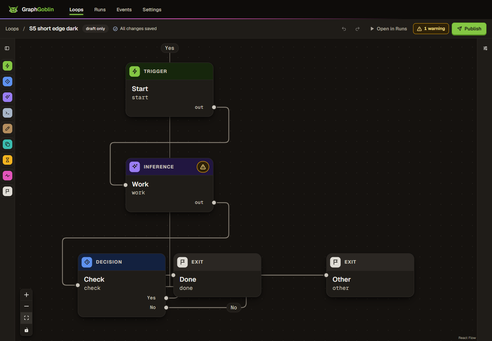
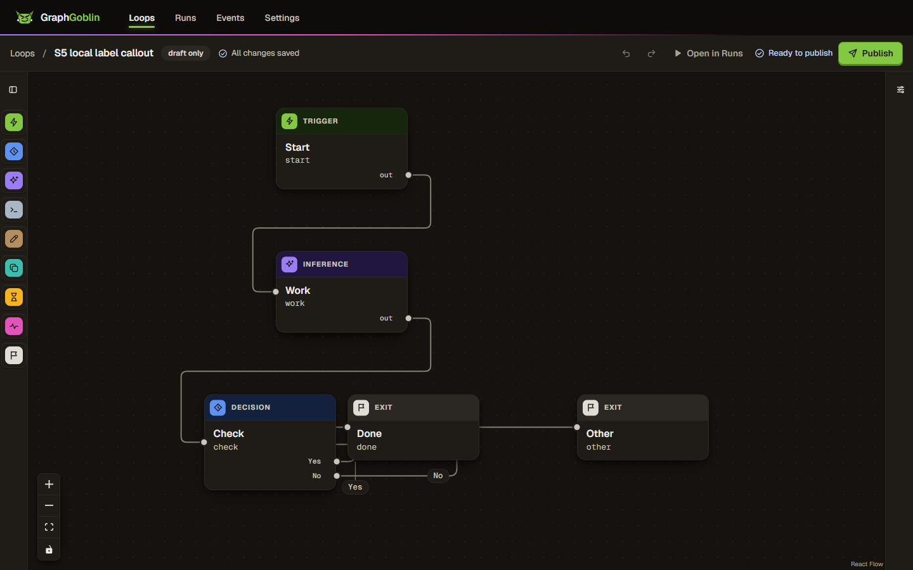

# WP-425: palette placement and edge labels

Branch `codex-wp-425-placement`, base `a4fee9a95513a059ecb26484059c73b4c9b3de70`. Worktree `%USERPROFILE%\source\repos\GraphGoblin\.claude\worktrees\codex-wp-425-placement`. Initial implementation committed by the orchestrator as `894f4197`; fix round 1 changes remain uncommitted for orchestrator review.

## Placement rules

1. A pressed palette entry starts at x = 40, below the greatest existing `ui.y + card height`, with 22 px clearance. Height uses xyflow's measurement or the current port footprint, whichever is larger, so a just-grown Decision cannot use a stale shorter measurement. The footprint is 92 px without ports, or `94 + 20 * ports` px with ports (three ports: 154 px). The empty/negative-space floor is (40, 40). Only the new node is placed; existing positions and palette dragging retain their behavior. The existing pan-to-node call is retained.
2. Routed labels retain the router's reserved positions and shortening. Forward labels keep xyflow's default position when clear; collisions use stable edge-ID priority and the nearest free interval on their own segments, with 4 px separation and 10 px corner allowance. A finite local fallback searches up to 96 px from that edge; its pill clears cards, earlier labels and other lanes, and its straight leader never enters a card. If no legal local candidate exists, the normal label remains without a leader. Placements settle after edits and drag release; displaced labels follow their own segment during a drag. Edge types, paths and existing card positions are preserved. Only displaced labels use per-edge view channels.

The card footprint follows `NodeCard.tsx`'s fixed header, padding, text line heights and port rows; real measurements cover additional rendered height. Label envelopes share the router's 7 px character estimate, 18 px padding allowance and 22 px height. These are engineering parameters, not additional owner decisions.

## Red before

The initial build was the supplied `main` baseline in this worktree, without switching branches. The production palette formula was extracted unchanged to test its old behavior; the initial label function reproduced independent preferred-point placement. The completed initial-round suite has 12 tests: **11 failed, 1 passed** against main (independent review replay). The earlier [unit baseline](unit-before.log.txt) captures the then-current nine-test suite: 8 failed, 1 passed. In particular:

- `clears a Decision with three ports before its first DOM measurement`: expected y >= 476, received 440.
- `separates Finish and Limit reached on lanes into the same target only 20px apart`: `expected true to be false` for intersecting envelopes.

The default-discovered `apps/web/e2e/palette-placement.spec.ts` creates a disposable draft through the fake API fixture, removes its seed nodes, then presses palette entries for Trigger, Inference, Decision, Wait and Exit. It edits the Decision to Again/Finish plus Limit reached before adding Wait, manually drags Exit to the right, and creates all six F2 connections through the dialog. No run or provider turn is started. This intentionally covers the forward-label path as well as palette placement. The authoring state is publishable; publication is not needed for this geometry check.

[Browser baseline](browser-before.log.txt) fails both exact assertions: `node-decision / node-wait` and `Finish / Limit reached`. The same 1440 × 1000 viewport, Fit View and one zoom-out are used for both captures.

| Baseline main                                        | After                                    |
| ---------------------------------------------------- | ---------------------------------------- |
|  |  |

## Tests

- `node-placement.test.ts`: three-port Decision before measurement; lowest bottom rather than lowest top; larger real/stale smaller measurements; empty/missing/negative coordinates; Script ports and exits; input preservation.
- `edge-label-placement.test.ts`: converging labels; collisions across unrelated horizontal/vertical paths; three-way collisions and input-order stability; isolated/empty labels; reversed rounded corners; card avoidance; attached fallback; unavailable, degenerate and short paths.
- `Palette.test.tsx`: pressing Wait clears a three-port Decision and preserves every existing node; existing drag/keyboard tests remain.
- `OrthogonalEdge.test.tsx`: shared label coordinates, full text and leader rendering. `route-channels.test.ts`: label-only updates/removal, equality suppression and unchanged route snapshots. Existing Canvas tests continue to check route editing and edge-object identity.
- `palette-placement.spec.ts`: the F2 graph, pan visibility after additions, no intersecting card boxes and no intersecting label boxes, driven in headless Edge through the repository fixture.
- `palette.spec.ts`: rail, keyboard, drag, theme and coarse-pointer regressions.
- `edge-routes.spec.ts`: manual routes, keyboard nudges, undo/redo, crossings, persistence, export/import, publishing and forced colors.

The first broader browser run had two timing failures ([terminal summary](browser-initial.log.txt); the raw log was superseded): route nudges exceeded the history's 1000 ms grouping window, and the drag used a viewport that had not settled. An isolated baseline-source comparison passed both ([comparison](browser-main-comparison.log.txt)). The test now uses Playwright's public `clock.setFixedTime` for the intended quick nudge sequence (timers still run), waits for fonts before fitting, and requires the viewport style to stay stable for 220 ms before using pointer offsets. This changes test synchronization only. The new palette spec also waits for the existing 200 ms pan to settle. The final broader run passes all 15 tests without retries ([result](browser-after.log.txt)).

The first full coverage run started before the final reversed-corner correction. Its cached module returned x = 30 while the newly added regression expected x = 40 ([initial coverage](coverage-initial.log.txt): 154 files/1831 tests passed, one regression failed). The finished module passes the regression in the final 58-test focused run ([focused result](unit-after.log.txt)). Full coverage was restarted against the finished source and passes all 155 files / 1832 tests; no production or test source was edited during that run. [Source snapshot](source-snapshot.log.txt) identifies its inputs and was verified again after completion.

Initial implementation `@graphgoblin/web` coverage: **98.94% lines (8176/8263)**, **94.81% branches (8682/9157)**, 98.11% statements (9369/9549), and 98.11% functions (2505/2553). Thresholds and exclusions are unchanged.

## Gates

All pnpm commands use Windows PowerShell's `pnpm.cmd`. [Runtime](runtime.log.txt): Node v22.23.4, `%USERPROFILE%\.claude\codex-runs\GraphGoblin\runtime\node-v22.23.4-win-x64\node.exe`; pnpm 12.8.1. Dependencies were already present; no installation or dependency change.

| Command                                                                                                                    | Result                                         | Evidence                                                                                                                                                                                  |
| -------------------------------------------------------------------------------------------------------------------------- | ---------------------------------------------- | ----------------------------------------------------------------------------------------------------------------------------------------------------------------------------------------- |
| `pnpm.cmd build`                                                                                                           | PASS: 11/11 tasks, 10 cached; web rebuilt      | [build](build-after.log.txt)                                                                                                                                                              |
| `pnpm.cmd typecheck`                                                                                                       | PASS: 20/20 tasks, 19 cached                   | [typecheck](typecheck.log.txt)                                                                                                                                                            |
| `pnpm.cmd lint`                                                                                                            | PASS: 12/12 tasks, 11 cached                   | [lint](lint.log.txt)                                                                                                                                                                      |
| `pnpm.cmd test:coverage --filter @graphgoblin/web`                                                                         | PASS: 155 files, 1832 tests; 1/1 uncached task | [coverage](coverage.log.txt)                                                                                                                                                              |
| `pnpm.cmd --filter @graphgoblin/web test <six focused editor files>`                                                       | PASS: 6 files, 58 tests                        | [focused tests](unit-after.log.txt)                                                                                                                                                       |
| From `apps/web`: `pnpm.cmd exec playwright test e2e/palette-placement.spec.ts e2e/palette.spec.ts e2e/edge-routes.spec.ts` | PASS: 15/15, headless msedge, retries 0        | [Edge](browser-after.log.txt)                                                                                                                                                             |
| `pnpm.cmd check:layers`                                                                                                    | PASS                                           | [additional gates](additional-gates.log.txt)                                                                                                                                              |
| `pnpm.cmd check:deps`                                                                                                      | PASS: zero errors, three existing warnings     | [additional gates](additional-gates.log.txt)                                                                                                                                              |
| `pnpm.cmd check:tokens`                                                                                                    | PASS: 183 files checked                        | [additional gates](additional-gates.log.txt)                                                                                                                                              |
| `pnpm.cmd exec prettier --write <changed files>` and `--check <changed files>`                                             | PASS                                           | [format](format.log.txt). Explicit paths only: the root `format` script hardcodes `--write .`, so its Prettier command is invoked with the changed file list to keep the requested scope. |

## Scope and evidence

- Web production files: `editor/node-placement.ts`, `editor/edge-label-placement.ts`, `editor/Palette.tsx`, `editor/routing-geometry.ts`, `editor/Canvas.tsx`, `editor/OrthogonalEdge.tsx`, `editor/route-channels.ts`, and `styles/canvas-routes.css`. Tests: the two new pure test files, Palette/OrthogonalEdge/channel component tests, new `e2e/palette-placement.spec.ts`, and synchronization changes in `e2e/edge-routes.spec.ts`. Existing Canvas and palette browser tests are exercised without source changes.

- Changed package: `@graphgoblin/web` only. No API, schema, stored-content or dependency changes; no migrations, generated references or license edits are needed.
- Shared-file edit: exactly one additive bullet at the top of `CHANGELOG.md` Unreleased, ending `(#425)`. Numbered behavior docs: `docs/09-frontend-and-pwa.md`; guide: `docs/guide/02-build-a-loop.md`. No ADR decision change.
- Real provider turns: **0**. Gate environments strip inherited `JEV_API_KEY` and every `GG_*` variable, then set `GG_TEST_DATA_PREFIX=gg-425-`, the allocated test port range 6330–6339 and explicit `GG_E2E_BROWSER_CHANNEL=msedge`. The repository's fake API/control fixtures listen on ephemeral loopback ports. The owner's app/store, other worktrees and provider logins are untouched.
- Baseline comparison: [baseline.vite.config.mjs](baseline.vite.config.mjs) loads the changed runtime modules directly from Git objects at `a4fee9a9`, builds into `%TEMP%\gg-425-main-comparison-dist`, and leaves the working source unchanged. [Build](build-main-comparison.log.txt). The regular `apps/web/dist` remains the fixed build.
- Raw text evidence is UTF-8 without BOM, with profile paths, machine name and SIDs redacted. Every retained file is below 1,000,000 bytes. Temporary coverage/build/browser outputs and the comparison dist are left for the orchestrator; no directory was manually deleted.
- Some successful Turbo tasks print `WARNING IO error: Access is denied. (os error 5)` after their output; task exit codes and the resulting web build are recorded separately. Dependency-cruiser reports three existing no-orphans warnings and zero errors ([additional gates](additional-gates.log.txt)).

The [final artifact audit](audit.log.txt) verifies text encoding/redaction, artifact size bounds, the 15 source/spec hashes, whitespace, branch/HEAD and the clean index.

No commit, index change, push, merge, rebase, stash or branch switch was made. Review and commit remain with the orchestrator.

## Fix round 1

Reviewed starting point: `894f4197a0d5e94575d75614ad4c3186cdc43449`; independent [review](REVIEW.md). All new work remains uncommitted. No branch, index, dependency, API, stored format or provider changes. Every earlier capture is retained; only the stray PowerShell `System.Management.Automation.RemoteException` lines were removed from the original unit log. The earlier nine-test baseline and the reviewer's completed 12-test replay are now distinguished above.

The label solver expands card obstacles once per settlement and uses a 256 px spatial grid for nearby card/label candidates. Clear forward labels keep xyflow's position and stock renderer; routed labels reserve their actual shortened text first. The lazy cache returns its prior overrides during node and route drags without even preparing inputs. Shifted labels follow their own segment; collisions settle on release. The 96 px callout bound is an engineering limit, with 4 px search increments near segment projections, midpoints and ends. Every candidate has a pill clear of cards/labels/unrelated lanes and an axis-aligned leader checked against card interiors. A fully covered path keeps its default label without an unsafe leader; this change does not relocate existing overlapping cards.

Forward edges retain the `smoothstep` type through a label move. `ForwardEdge` uses xyflow's stock renderer unless a displacement needs the existing channel; selection, backward direction and authored routes still select `orthogonal`. Routed ellipsis shortening, full title and accessible name are retained. `gg:backward-routing` now reports routing plus label preparation/placement in **one observer sample**, with `routingMs` and `labelMs` detail. A label-only settlement reports zero routing time. No gate exclusion, threshold, performance assertion or `routing.spec.ts` change was made.

The new fallback and shortening regressions were [red before](fix-round-1/unit-red-before.log.txt): **2 failed, 17 passed** against the reviewed implementation. Focused tests additionally guard measured labelled forward types, routed reservation ownership, attachment notifications, a multi-card squeezed callout, an unrelated lane beside a long callout, and zero input preparation/solving across **80 frames / 300 cards / 600 paths**. The initial geometry budget implementation emitted both a raw routing sample and its combined replacement; it was corrected to defer publication until labels finish, and the unit test asserts a single sample.

### Performance measurements

Node v22.23.4, pnpm 12.8.1; the runtime executable remains `%USERPROFILE%\.claude\codex-runs\GraphGoblin\runtime\node-v22.23.4-win-x64\node.exe`. All runs use the repository's `denseGraph(300)` geometry. The [before diagnostic](fix-round-1/node-before.log.txt) is the reviewer's unchanged `label-bench.mts`, which reconstructs every label each frame. The repository [routing benchmark](../../../apps/web/e2e/routing-benchmark.ts) now measures the production lazy cache too, exposing both phases and preparation counts. Main's five pure routing modules were read from Git objects at `a4fee9a9` into a disposable `gg-425-` folder; the optional baseline-module argument disables the label pass, matching main. Neither source checkout nor branch was switched.

| Node 300-card drag                   | Router p50 / p95 ms | Label p50 / p95 ms | Combined p50 / p95 ms         |
| ------------------------------------ | ------------------- | ------------------ | ----------------------------- |
| Reviewed implementation, before      | 3.767 / 10.473      | 44.313 / 61.460    | Not timed as a combined phase |
| Exact main modules, final paired run | 1.5690 / 2.8487     | No label pass      | 1.5696 / 2.8499               |
| Fix, final paired run                | 1.5440 / 2.7911     | 0.0006 / 0.0011    | 1.5445 / 2.7919               |

Final paired Node combined cost is **1.60% lower at p50, 2.04% lower at p95** than main, within the 10% target. Label preparation happens once across all 80 drag steps; that one settlement costs **15.7760 ms**, outside pointer-move frames. Raw samples: [main](fix-round-1/node-main-final.json), [fix](fix-round-1/node-after-final.json); [main log](fix-round-1/node-main-final.log.txt), [fix log](fix-round-1/node-after-final.log.txt). Earlier diagnostic runs are retained beside these final reports.

The repository's unmodified headless Edge performance specs use three real five-second CDP pointer drags per test. The baseline Vite [configuration](fix-round-1/main.vite.config.mjs) reads main's seven affected runtime modules directly from Git objects; [build](fix-round-1/main-build.log.txt). The first pair reproduced the reviewed slowdown, then removed it, but showed host acknowledgement variation near the 10% limit. A final paired repetition was therefore run after correcting the single-sample measurement, with CPU-heavy gates kept outside the measurement windows. Every first report is retained ([before](fix-round-1/edge-before-performance.log.txt), [main](fix-round-1/edge-main-performance.log.txt), [initial fix](fix-round-1/edge-after-performance.log.txt)).

| First Edge 300-node run | Observed pointer moves, of 306 sent | Acknowledgement p95 ms | Median routing p95 ms     |
| ----------------------- | ----------------------------------- | ---------------------- | ------------------------- |
| Before fix              | 105 / 100 / 106                     | 72 / 69 / 72           | 3.8 (excludes label work) |
| Main                    | 260 / 260 / 243                     | 33 / 33 / 32           | 2.7                       |
| Initial fix             | 276 / 249 / 227                     | 29 / 37 / 37           | 2.3 (includes labels)     |

### Browser regressions and synchronization

The first complete requested functional run had **114 passed, 2 failed** ([log](fix-round-1/edge-functional.log.txt)); all 21 unmodified functional routing checks passed, including both six-return counts and long-label shortening. The failures were navigation/focus races. The same tests on main reproduced both: **1 passed, 2 failed** ([comparison](fix-round-1/edge-main-navigation.log.txt)). `loop-lifecycle`'s broad `getByLabel('Loop')` matched six departing editor controls before New Run's selector loaded; it now uses the exact label. `responsive` sent Enter while xyflow still marked the initial wrapper `visibility: hidden` (confirmed in the trace); it now uses `openDraftTab`, explicitly waits for the measured wrapper to become visible, and presses Enter on that locator. No assertion was weakened and no retry was enabled. A new default-discovered `edge-labels.spec.ts` checks the S5 multi-card callout's smoothstep type, 96 px bound, leader/card intersections and pill/card intersections, and captures the result.

| Final paired Edge 300-node run | Observed moves (306 sent each) | Acknowledgement p95 ms | Routing + labels p95 ms |
| ------------------------------ | ------------------------------ | ---------------------- | ----------------------- |
| Main, repetition 1             | 272 / 283 / 286                | 32 / 30 / 32           | 2.6 / 1.9 / 1.8         |
| Main, repetition 2             | 283 / 282 / 283                | 30 / 33 / 32           | 2.1 / 2.0 / 1.9         |
| Fix, repetition 1              | 285 / 282 / 286                | 33 / 32 / 31           | 2.1 / 1.9 / 1.9         |
| Fix, repetition 2              | 285 / 270 / 285                | 32 / 33 / 33           | 2.0 / 1.9 / 1.7         |

Across the six paired drags, median observed moves are **283 main / 285 fix (+0.71%)**, median acknowledgement p95 is **32.0 / 32.5 ms (+1.56%)**, and median geometry p95 is **1.95 / 1.90 ms (-2.56%)**. The 10% target is met in Edge and Node. Final reports: [main 1](fix-round-1/edge-main-final-300-repeat-1.json), [main 2](fix-round-1/edge-main-final-300-repeat-2.json), [fix 1](fix-round-1/edge-after-final-300-repeat-1.json), [fix 2](fix-round-1/edge-after-final-300-repeat-2.json); [main log](fix-round-1/edge-main-performance-paired.log.txt), [full routing log](fix-round-1/edge-routing-final.log.txt).

The unmodified `routing.spec.ts --repeat-each=2` finishes **42 functional checks passed, 4 performance executions failed**, exactly the known `frameSamples > 120` assertion (both 100- and 300-node tests, twice). Main's paired 300-node runs have 60/60/60 and 61/61/60 frames per five-second drag; the fix has 60/61/60 and 59/60/60. Main idle frame p95 is 93.9/94.8 ms, fix 89.7/94.3 ms. This host cannot satisfy the unchanged frame-count assertion even while idle. Those failures are retained, not reported as passes.

The first new callout browser assertion used Playwright's `toBeVisible` on a vertical SVG path: its zero-width layout box is considered hidden even though its stroke is painted. It now checks attachment, painted stroke and actual SVG geometry. The initial responsive readiness fix alone also proved insufficient; the trace showed `visibility: hidden`, so the explicit measured-wrapper assertion was added. The [final focused run](fix-round-1/edge-sync-and-callout-final.log.txt) passes **4/4**, retries 0. The [earlier attempt](fix-round-1/edge-sync-and-callout.log.txt) is retained. The callout capture was visually inspected: Yes stays beside/below its short path with a 36 px leader, clear of every card.

| S5 before fix                                                    | S5 local callout after fix                                                       |
| ---------------------------------------------------------------- | -------------------------------------------------------------------------------- |
|  |  |

The original F2 before/after captures remain above. [F2 after fix round 1](fix-round-1/f2-after.png) again passes both box-intersection assertions. Existing-card placement was confirmed by the review and is unchanged in this round. The original F2 order with Wait added before Decision growth remains within option A; the pre-existing long port-row overprint and stub-handle/pill intersection remain outside scope.

| 100-node performance spec | Median routing p95 ms | Idle frame p95 ms | Drag frame counts |
| ------------------------- | --------------------- | ----------------- | ----------------- |
| Main (first baseline)     | 1.3                   | 93.8              | 59 / 59 / 57      |
| Final fix, repetition 1   | 1.1                   | 93.8              | 60 / 60 / 60      |
| Final fix, repetition 2   | 1.1                   | 94.4              | 58 / 58 / 59      |

Reports: [main 100](fix-round-1/edge-main-100.json), [fix 100 repetition 1](fix-round-1/edge-after-final-100-repeat-1.json), [fix 100 repetition 2](fix-round-1/edge-after-final-100-repeat-2.json). These also fail only the unchanged frame-count assertion.

Lint required `this: void` on the two detached timer callbacks. The initial coverage run was interrupted before making that change ([partial capture](fix-round-1/coverage-interrupted.log.txt)); no pass is claimed for it. Lint, typecheck and build were then rerun successfully, and coverage restarted against the final source snapshot. The annotations erase at runtime: both pre/post builds emit the same `index-CIZ0gDR4.js`, so the final paired performance measurements cover the shipped JavaScript. No application source or test is edited during the restarted coverage run.

### Final gates and handoff

The final requested functional set plus the new callout spec passes **117/117**, retries 0, headless Microsoft Edge channel `msedge` ([full log](fix-round-1/edge-functional-final.log.txt), [per-spec counts](fix-round-1/browser-results.md)). This includes `routing` 21, `palette-placement` 1, `palette` 4, `edge-routes` 10, `decision-routes` 12, `undo` 14, `responsive` 22, `qa` 10, `loop-lifecycle` 2, `drafts` 3, `device-first` 6, `node-placement` 11, and new `edge-labels` 1. The unchanged full routing spec was also repeated twice: 42 functional checks passed; its four performance executions retained only the main-equivalent host frame-count failure documented above.

| Gate                                                    | Final result                                                                   | Evidence                                                     |
| ------------------------------------------------------- | ------------------------------------------------------------------------------ | ------------------------------------------------------------ |
| `pnpm.cmd build`                                        | PASS, 11/11 tasks, 10 cached                                                   | [build](fix-round-1/build-pass.log.txt)                      |
| `pnpm.cmd typecheck`                                    | PASS, 20/20 tasks, 19 cached                                                   | [typecheck](fix-round-1/typecheck-pass.log.txt)              |
| `pnpm.cmd lint`                                         | PASS, 12/12 tasks, 11 cached                                                   | [lint](fix-round-1/lint-pass.log.txt)                        |
| `pnpm.cmd test:coverage --filter @graphgoblin/web`      | PASS, 155 files / 1842 tests, uncached                                         | [coverage](fix-round-1/coverage-final.log.txt)               |
| Focused unit suite                                      | PASS, 7 files / 73 tests                                                       | [units](fix-round-1/unit-final-2.log.txt)                    |
| All requested functional Edge specs, plus `edge-labels` | PASS, 117/117, retries 0                                                       | [Edge](fix-round-1/edge-functional-final.log.txt)            |
| Unchanged `routing.spec.ts --repeat-each=2`             | 42 functional passes; 4 expected host frame-count failures                     | [routing](fix-round-1/edge-routing-final.log.txt)            |
| `check:layers`                                          | PASS                                                                           | [layers](fix-round-1/layers.log.txt)                         |
| `check:deps`                                            | PASS, 0 errors / 3 existing no-orphans warnings                                | [dependencies](fix-round-1/deps.log.txt)                     |
| `check:tokens`                                          | PASS, 184 files                                                                | [tokens](fix-round-1/tokens.log.txt)                         |
| Format changed files only                               | PASS, explicit Prettier write/check paths; root `format` hardcodes `--write .` | [final format check](fix-round-1/format-check-final.log.txt) |

Final web coverage: **98.93% lines (8281/8370), 94.80% branches (8768/9248), 98.08% statements (9487/9672), 98.09% functions (2525/2574)**. Thresholds and exclusions are unchanged. Coverage finished in 760.09 s; the root gate reports 1/1 uncached task. All 15 source/spec hashes in [the frozen snapshot](fix-round-1/source-snapshot.log.txt) are checked again in the [final audit](fix-round-1/audit-final.log.txt).

Round 1 changes only `@graphgoblin/web` and its docs/evidence. New production component: `ForwardEdge.tsx`; new browser spec: `edge-labels.spec.ts`; the existing placement module, canvas, renderer, channels, routing timing and associated tests/benchmark are updated. The original palette/card-height implementation is retained. Numbered doc `docs/09-frontend-and-pwa.md` now states the measured-height maximum, unchanged edge types, routed shortening, settlement timing and bounded callout rule. The guide already describes palette placement correctly.

Exact shared-file changes this round: `apps/web/src/editor/OrthogonalEdge.tsx` follows cached edge attachments and no longer replaces shortened routed text with full text. `Palette.tsx`, `routing-geometry.ts` and `CHANGELOG.md` have no round-1 edits; the existing single top Unreleased bullet for #425 remains. No ADR, schema, API, dependency, migration or generated-reference change is needed.

Real provider turns: **0**. Runtime: Node **v22.23.4**, executable `%USERPROFILE%\.claude\codex-runs\GraphGoblin\runtime\node-v22.23.4-win-x64\node.exe`; pnpm **12.8.1**. Test/gateway environments stripped inherited `GG_*` and `JEV_API_KEY`, then selected `gg-425-`, ports 6330–6339 and `msedge`; repository fake fixtures use ephemeral loopback ports. Temporary outputs are left for the orchestrator. Compressed traces are identified, without copying them, in [NOT-KEPT](fix-round-1/NOT-KEPT.md). Every retained artifact is UTF-8 without BOM where textual, redacted, and below 1,000,000 bytes.

Branch remains `codex-wp-425-placement`, HEAD `894f4197a0d5e94575d75614ad4c3186cdc43449`. All round-1 changes remain **uncommitted**; the index is unchanged. No commit, push, merge, rebase, stash, branch switch, manual directory deletion or link creation was performed. Remaining caveats are the main-equivalent frame sampler limit, the documented fully-covered-path fallback, and the two pre-existing visual issues excluded by the review. Independent review and commit remain with the orchestrator.
