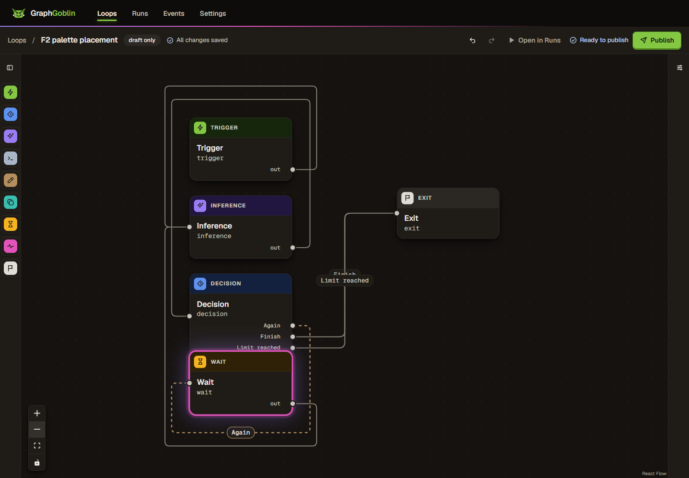
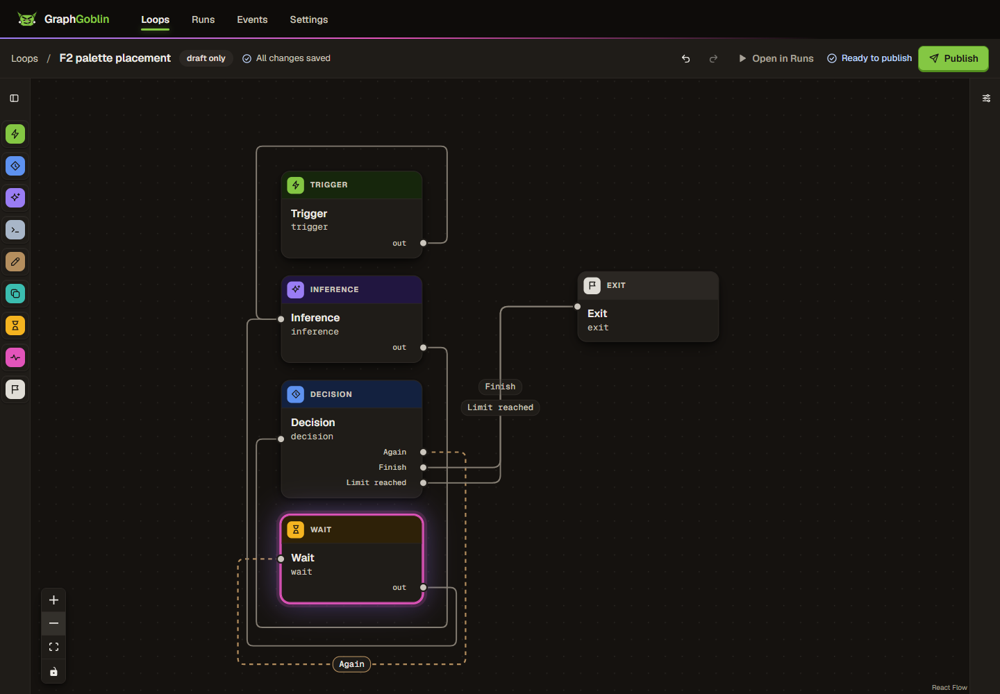

# WP-425: palette placement and edge labels

Branch `codex-wp-425-placement`, base `a4fee9a95513a059ecb26484059c73b4c9b3de70`. Worktree `%USERPROFILE%\source\repos\GraphGoblin\.claude\worktrees\codex-wp-425-placement`. Uncommitted; orchestrator review and commit remain separate.

## Placement rules

1. A pressed palette entry starts at x = 40, below the greatest existing `ui.y + card height`, with 22 px clearance. Height uses xyflow's measurement or the current port footprint, whichever is larger, so a just-grown Decision cannot use a stale shorter measurement. The footprint is 92 px without ports, or `94 + 20 * ports` px with ports (three ports: 154 px). The empty/negative-space floor is (40, 40). Only the new node is placed; existing positions and palette dragging retain their behavior. The existing pan-to-node call is retained.
2. All displayed edge labels, including forward smoothstep labels, reserve full pill bounds in stable edge-ID order. The nearest clear interval on the edge's horizontal/vertical segments wins, with 4 px separation from cards/earlier pills and 10 px corner allowance. Short or covered paths use an explicit leader from a clear callout to the nearest point on that edge. Label placement preserves paths and card positions. Label geometry travels through the existing per-edge channels, so unrelated xyflow edge objects retain their identities.

The card footprint follows `NodeCard.tsx`'s fixed header, padding, text line heights and port rows; real measurements cover additional rendered height. Label envelopes share the router's 7 px character estimate, 18 px padding allowance and 22 px height. These are engineering parameters, not additional owner decisions.

## Red before

The initial build was the supplied `main` baseline in this worktree, without switching branches. The production palette formula was extracted unchanged to test its old behavior; the initial label function reproduced independent preferred-point placement. [Unit baseline](unit-before.log.txt): 8 failed, 1 passed. In particular:

- `clears a Decision with three ports before its first DOM measurement`: expected y >= 476, received 440.
- `separates Finish and Limit reached on lanes into the same target only 20px apart`: `expected true to be false` for intersecting envelopes.

The default-discovered `apps/web/e2e/palette-placement.spec.ts` creates a disposable draft through the fake API fixture, removes its seed nodes, then presses palette entries for Trigger, Inference, Decision, Wait and Exit. It edits the Decision to Again/Finish plus Limit reached before adding Wait, manually drags Exit to the right, and creates all six F2 connections through the dialog. No run or provider turn is started. This intentionally covers the forward-label path as well as palette placement. The authoring state is publishable; publication is not needed for this geometry check.

[Browser baseline](browser-before.log.txt) fails both exact assertions: `node-decision / node-wait` and `Finish / Limit reached`. The same 1440 × 1000 viewport, Fit View and one zoom-out are used for both captures.

| Baseline main                                        | After                                    |
| ---------------------------------------------------- | ---------------------------------------- |
|  |  |

## Tests

- `node-placement.test.ts`: three-port Decision before measurement; lowest bottom rather than lowest top; larger real/stale smaller measurements; empty/missing/negative coordinates; Script ports and exits; input preservation.
- `edge-label-placement.test.ts`: converging labels; collisions across unrelated horizontal/vertical paths; three-way collisions and input-order stability; isolated/empty labels; reversed rounded corners; card avoidance; attached fallback; unavailable, degenerate and short paths.
- `Palette.test.tsx`: pressing Wait clears a three-port Decision and preserves every existing node; existing drag/keyboard tests remain.
- `OrthogonalEdge.test.tsx`: shared label coordinates, full text and leader rendering. `route-channels.test.ts`: label-only updates/removal, equality suppression and unchanged route snapshots. Existing Canvas tests continue to check route editing and edge-object identity.
- `palette-placement.spec.ts`: the F2 graph, pan visibility after additions, no intersecting card boxes and no intersecting label boxes, driven in headless Edge through the repository fixture.
- `palette.spec.ts`: rail, keyboard, drag, theme and coarse-pointer regressions.
- `edge-routes.spec.ts`: manual routes, keyboard nudges, undo/redo, crossings, persistence, export/import, publishing and forced colors.

The first broader browser run had two timing failures ([terminal summary](browser-initial.log.txt); the raw log was superseded): route nudges exceeded the history's 1000 ms grouping window, and the drag used a viewport that had not settled. An isolated baseline-source comparison passed both ([comparison](browser-main-comparison.log.txt)). The test now uses Playwright's public `clock.setFixedTime` for the intended quick nudge sequence (timers still run), waits for fonts before fitting, and requires the viewport style to stay stable for 220 ms before using pointer offsets. This changes test synchronization only. The new palette spec also waits for the existing 200 ms pan to settle. The final broader run passes all 15 tests without retries ([result](browser-after.log.txt)).

The first full coverage run started before the final reversed-corner correction. Its cached module returned x = 30 while the newly added regression expected x = 40 ([initial coverage](coverage-initial.log.txt): 154 files/1831 tests passed, one regression failed). The finished module passes the regression in the final 58-test focused run ([focused result](unit-after.log.txt)). Full coverage was restarted against the finished source and passes all 155 files / 1832 tests; no production or test source was edited during that run. [Source snapshot](source-snapshot.log.txt) identifies its inputs and was verified again after completion.

Final `@graphgoblin/web` coverage: **98.94% lines (8176/8263)**, **94.81% branches (8682/9157)**, 98.11% statements (9369/9549), and 98.11% functions (2505/2553). Thresholds and exclusions are unchanged.

## Gates

All pnpm commands use Windows PowerShell's `pnpm.cmd`. [Runtime](runtime.log.txt): Node v22.23.4, `%USERPROFILE%\.claude\codex-runs\GraphGoblin\runtime\node-v22.23.4-win-x64\node.exe`; pnpm 12.8.1. Dependencies were already present; no installation or dependency change.

| Command                                                                                                                    | Result                                         | Evidence                                                                                                                                                                                  |
| -------------------------------------------------------------------------------------------------------------------------- | ---------------------------------------------- | ----------------------------------------------------------------------------------------------------------------------------------------------------------------------------------------- |
| `pnpm.cmd build`                                                                                                           | PASS: 11/11 tasks, 10 cached; web rebuilt      | [build](build-after.log.txt)                                                                                                                                                              |
| `pnpm.cmd typecheck`                                                                                                       | PASS: 20/20 tasks, 19 cached                   | [typecheck](typecheck.log.txt)                                                                                                                                                            |
| `pnpm.cmd lint`                                                                                                            | PASS: 12/12 tasks, 11 cached                   | [lint](lint.log.txt)                                                                                                                                                                      |
| `pnpm.cmd test:coverage --filter @graphgoblin/web`                                                                         | PASS: 155 files, 1832 tests; 1/1 uncached task | [coverage](coverage.log.txt)                                                                                                                                                              |
| `pnpm.cmd --filter @graphgoblin/web test <six focused editor files>`                                                       | PASS: 6 files, 58 tests                        | [focused tests](unit-after.log.txt)                                                                                                                                                       |
| From `apps/web`: `pnpm.cmd exec playwright test e2e/palette-placement.spec.ts e2e/palette.spec.ts e2e/edge-routes.spec.ts` | PASS: 15/15, headless msedge, retries 0        | [Edge](browser-after.log.txt)                                                                                                                                                             |
| `pnpm.cmd check:layers`                                                                                                    | PASS                                           | [additional gates](additional-gates.log.txt)                                                                                                                                              |
| `pnpm.cmd check:deps`                                                                                                      | PASS: zero errors, three existing warnings     | [additional gates](additional-gates.log.txt)                                                                                                                                              |
| `pnpm.cmd check:tokens`                                                                                                    | PASS: 183 files checked                        | [additional gates](additional-gates.log.txt)                                                                                                                                              |
| `pnpm.cmd exec prettier --write <changed files>` and `--check <changed files>`                                             | PASS                                           | [format](format.log.txt). Explicit paths only: the root `format` script hardcodes `--write .`, so its Prettier command is invoked with the changed file list to keep the requested scope. |

## Scope and evidence

- Web production files: `editor/node-placement.ts`, `editor/edge-label-placement.ts`, `editor/Palette.tsx`, `editor/routing-geometry.ts`, `editor/Canvas.tsx`, `editor/OrthogonalEdge.tsx`, `editor/route-channels.ts`, and `styles/canvas-routes.css`. Tests: the two new pure test files, Palette/OrthogonalEdge/channel component tests, new `e2e/palette-placement.spec.ts`, and synchronization changes in `e2e/edge-routes.spec.ts`. Existing Canvas and palette browser tests are exercised without source changes.

- Changed package: `@graphgoblin/web` only. No API, schema, stored-content or dependency changes; no migrations, generated references or license edits are needed.
- Shared-file edit: exactly one additive bullet at the top of `CHANGELOG.md` Unreleased, ending `(#425)`. Numbered behavior docs: `docs/09-frontend-and-pwa.md`; guide: `docs/guide/02-build-a-loop.md`. No ADR decision change.
- Real provider turns: **0**. Gate environments strip inherited `JEV_API_KEY` and every `GG_*` variable, then set `GG_TEST_DATA_PREFIX=gg-425-`, the allocated test port range 6330–6339 and explicit `GG_E2E_BROWSER_CHANNEL=msedge`. The repository's fake API/control fixtures listen on ephemeral loopback ports. The owner's app/store, other worktrees and provider logins are untouched.
- Baseline comparison: [baseline.vite.config.mjs](baseline.vite.config.mjs) loads the changed runtime modules directly from Git objects at `a4fee9a9`, builds into `%TEMP%\gg-425-main-comparison-dist`, and leaves the working source unchanged. [Build](build-main-comparison.log.txt). The regular `apps/web/dist` remains the fixed build.
- Raw text evidence is UTF-8 without BOM, with profile paths, machine name and SIDs redacted. Every retained file is below 1,000,000 bytes. Temporary coverage/build/browser outputs and the comparison dist are left for the orchestrator; no directory was manually deleted.
- Some successful Turbo tasks print `WARNING IO error: Access is denied. (os error 5)` after their output; task exit codes and the resulting web build are recorded separately. Dependency-cruiser reports three existing no-orphans warnings and zero errors ([additional gates](additional-gates.log.txt)).

The [final artifact audit](audit.log.txt) verifies text encoding/redaction, artifact size bounds, the 15 source/spec hashes, whitespace, branch/HEAD and the clean index.

No commit, index change, push, merge, rebase, stash or branch switch was made. Review and commit remain with the orchestrator.
