SIGN-OFF: WP-425 at 292254545daa6c88471cfb35e4ff4a7327bf7981 may merge.

The five findings below are P3. None blocks the merge. Findings 1 and 4 are wording that the orchestrator can fix in the merge commit. Finding 1 also needs an owner-facing note.

# Independent review of WP-425 (issue #425), scan 2 of at most 3: after fix round 1

- **Reviewed commit:** `292254545daa6c88471cfb35e4ff4a7327bf7981` on branch `codex-wp-425-placement`, which is `894f4197` plus the fix-round commit.
  - Checked out detached in a separate reviewer worktree. HEAD is not scan 1's `894f4197`.
  - Diffs reviewed: `git diff a4fee9a9 HEAD`, and `git diff 894f4197 HEAD` for the fix.
- **Reviewer:** independent; I did not write this change.
  - No product code or test was changed, and nothing was committed.
  - Two untracked copies of `main`'s specs were used for one comparison and then removed (see "Method").
- **Runtime:** Node v22.23.4 at `%USERPROFILE%\.claude\codex-runs\GraphGoblin\runtime\node-v22.23.4-win-x64\node.exe`, pnpm 12.8.1, Microsoft Edge 156.0.4314.50 (Playwright channel `msedge`, headless).
  - `pnpm install --frozen-lockfile` passed ([install](review-2/logs/install.log.txt)).
  - `pnpm build` passed: 11 tasks, web bundle `index-CIZ0gDR4.js`, the hash the record names ([build](review-2/logs/build.log.txt)).
- **Real provider turns:** 0.
  - Every gateway and test environment had every `GG_*` variable and `JEV_API_KEY` removed.
  - Reviewer gateways pointed `GG_CODEX_BINARY` and `GG_CLAUDE_BINARY` at files that do not exist, and no run was started.

## Findings

### 1. P3: forward labels also move when nothing collides; docs/09 and the record say they do not

`placeEdgeLabels` keeps xyflow's default position only when two things hold:

- the default pill is clear of obstacles;
- the default point lies on a straight segment long enough for the pill plus the 10 px corner allowances (`fitsPreferred`).

xyflow puts a forward label at the middle of the path's vertical jog. When source port and target input are within about 42 px vertically (2 × 11 px half-height plus 2 × 10 px corners), the jog is too short. The label then moves to the nearest straight run, usually the stub beside the source port, even though it touches nothing.

- **Node, on the 300-card fixture** ([script](review-2/tools/displacement-reasons.mts), [log](review-2/logs/displacement-reasons.log.txt)): 296 of 298 forward labels leave their default.
  - 269 move only because of this fit rule;
  - 27 move because they touch a routed label;
  - none moves because of a card.
  - The 100-card fixture behaves the same way: 89 of 96 moves are for the fit rule.
- **Edge (S11):** after a drag on `denseGraph(300)`, 298 `smoothstep` edges render through the label channel. Compare the `next` pills in the [head](review-2/head-s11-dense-300-after-drag.png) and [main](review-2/main-s11-dense-300-after-drag.png) screenshots: on head they sit on the stub next to the port instead of on the jog.
- **The record and the docs say otherwise.**
  - The record says "Clear forward labels keep xyflow's position and stock renderer" (`README.md`, Fix round 1).
  - docs/09 says "Forward labels keep xyflow's default position when clear". The brief's example design was "the common case does no work".
  - The cache unit test's `settled.size === 0` uses straight synthetic paths only, so it does not show this.
- **What this does not affect.**
  - Drag performance: a moved label is held during a drag like any other (finding 1 of scan 1, below).
  - Correctness: the moved pill stays on its own path. It is arguably more readable, because it no longer covers two rounded corners.
- **Why the owner should hear about it.** It moves labels beyond option A's "labels of edges that share a target (or otherwise collide)". Layouts with nearly aligned ports will see their labels shift once.
- **Required:** either state the rule in docs/09 and correct the record's claims, or restrict moves to real collisions. Whichever is chosen, tell the owner.

### 2. P3: `edge-routes.spec.ts`'s `page.clock.setFixedTime` does not do what its comment says, and the keyboard test is still timing-dependent

The comment says the change keeps the nudges "within the 1s history grouping window even when HTTP assertions take longer". The history does not group by `Date.now`:

- `store.ts` records each step with `performance.now()` (lines 311, 490 and 676).
- `COALESCE_MS` is 1000 (`history.ts`).
- Playwright's `setFixedTime` freezes `Date.now` only. Measured in Edge: after a 1.5 s wait, `Date.now` advanced 0 ms and `performance.now()` advanced 1,518 ms ([script](review-2/tools/clock-check.mts), [log](review-2/logs/clock-check.log.txt)).

So the line is a no-op for the assertion it targets. In my full functional run under host load, "keyboard: Tab reaches the handles…" failed at "One undo takes the whole run of nudges back": `Received: 88`, so the nudges had split into two steps.

- It then passed 5 of 5 more times on head and 5 of 5 on main's build ([isolated](review-2/logs/edge-rerun-two-head.log.txt), [spec runs](review-2/logs/edge-decision-and-edge-routes-head.log.txt), [main](review-2/logs/edge-rerun-two-main.log.txt), [main spec runs](review-2/logs/edge-decision-and-edge-routes-main.log.txt)). The product is not at fault.
- Scan 1 accepted the line on the assumption that it removed the timing dependence. It does not.
- **Required:** drop the line and its comment, or make the test independent of the 1000 ms window another way. Do not keep a synchronisation step that does nothing.

### 3. P3: every drop runs three full label settlements

On `denseGraph(300)` in Edge (S11), releasing a dragged card produced one routing sample, then three label-only `gg:backward-routing` samples of 4.0 to 6.8 ms each, about 13 to 19 ms of main-thread work after one drop.

- **Cause:** the `labels` memo in `Canvas.tsx` depends on `cardData`. Its identity changes on the drop's definition commit, and again when issues are recomputed, although no port label changed.
- **Impact:** small, and none per drag frame.
- **Suggestion:** key the settlement on the port labels it reads, so one drop settles once.

### 4. P3: the record still describes fix round 1 as uncommitted

`README.md` line 3 says "fix round 1 changes remain uncommitted", line 77 says "All new work remains uncommitted", and line 164 says HEAD is `894f4197` with round-1 changes **uncommitted**. The round is now commit `29225454`. Update these lines when merging, as was done for scan 1's finding 4.

### 5. P3: the routed-label shortening rule now exists twice

The `labels` memo in `Canvas.tsx` repeats `OrthogonalEdge.tsx`'s full-label composition and its capacity and `…` rule, so the solver reserves the same text the edge draws. If one copy changes without the other, the reserved box and the drawn pill will differ. A shared helper (for example in `routing-labels.ts`) would keep them one rule.

## Scan-1 findings, re-verified

### Finding 1 (P1, drag performance): resolved

**How placement is scheduled now.**

- `Canvas.tsx` derives `moving` from `nodeDrag`, `routeDrag` and xyflow's dragging positions.
- While `moving` is true, `createLabelPlacementCache` returns the held map without calling `prepare()`. A drag frame therefore does no card collection, no obstacle expansion and no search.
- A label that was already displaced follows its own segment in `OrthogonalEdge` (`followEdgeLabel`).
- `route-channels.ts` compares label values before waking an edge.
- On release, `moving` turns false and one full solve runs (three solves: finding 3).
- `useRouting.ts`'s `createRoutingTimer` reports routing and label time as one `gg:backward-routing` sample with `routingMs` and `labelMs`. The unit test and the Edge samples both show one sample per plan, and `routingMs: 0` for a label-only settlement.

**Node, the 300-card fixture.** The [script](review-2/tools/label-bench-2.mts) uses scan 1's drag motion and Canvas's own `prepare()`. Runs: [1](review-2/logs/label-bench-2-run-1.log.txt), [2](review-2/logs/label-bench-2-run-2.log.txt).

| `denseGraph(300)`, 80 steady drag steps                   | Run 1           | Run 2           |
| --------------------------------------------------------- | --------------- | --------------- |
| Router p50 / p95 ms (`routing.ts` is unchanged from main) | 2.158 / 3.788   | 2.306 / 3.576   |
| Label cache while moving, p50 / p95 ms                    | 0.0020 / 0.0029 | 0.0024 / 0.0033 |
| `prepare()` calls during the 90-step drag                 | 0               | 0               |
| Channel publish p50 ms, with labels / with routes only    | 0.040 / 0.051   | 0.066 / 0.066   |
| One full settlement (edit, undo, drop), p50 / p95 ms      | 4.49 / 10.91    | 7.01 / 11.99    |
| Settlement at release, ms                                 | 4.51            | 6.31            |

`main` has no label pass, so its per-step cost is the router alone. The added per-step cost is about 0.1 % of the router's, far inside the 10 % target. That agrees with the implementer's 0.0006 / 0.0011 ms; my figure includes the closure call.

**Edge, `routing.spec.ts` performance tests, unchanged, paired.** I ran the builds in this order: main, head, main, head, main, head. That is three runs per build, each with three five-second drags at 100 and at 300 nodes, so nine drags per build and size ([summary script](review-2/tools/perf-summary.mjs); logs `review-2/logs/edge-perf-{main,head}-{1,2,3}.log.txt`).

| Median of 9 drags | Moves observed (306 sent) | Acknowledgement p95 ms | Routing samples | Routing p95 ms |
| ----------------- | ------------------------- | ---------------------- | --------------- | -------------- |
| main, 300 nodes   | 257                       | 35                     | 220             | 2.5            |
| head, 300 nodes   | 262 (+1.9 %)              | 33 (-5.7 %)            | 227             | 2.5            |
| main, 100 nodes   | 283                       | 33                     | 239             | 1.3            |
| head, 100 nodes   | 280 (-1.1 %)              | 33 (0 %)               | 240             | 1.3            |

- Per drag at 300 nodes:
  - main moves 230/232/259/232/259/257/253/270/268, acknowledgement p95 37/36/35/35/33/35/31/32/30 ms;
  - head moves 259/262/272/260/238/234/268/262/272, acknowledgement p95 30/34/34/32/40/34/33/33/31 ms.
- All 12 executions failed only `frameSamples > 120`, on both builds. Headless Edge drew 53 to 88 frames per five-second drag on this host, as scan 1 and the implementer found.
- A desktop process held about half the CPU throughout, so absolute numbers are higher than the implementer's. Paired, head is within noise of main on every measure, inside the 10 % target. That agrees with the implementer's 32.5 / 32.0 ms.

**Edge, label time inside a drag (S11).** I opened `denseGraph(300)` on the built API, dragged `n144` through 60 pointer moves and read every sample ([result](review-2/head-behaviour-result.json)).

- 59 samples arrived during the drag. `labelMs` was 0 in all of them (the largest was 0.1).
- **No flicker.** In S10, 64 sampled frames of dragging the shared target kept every label within 0.7 px of its own path, with no overlapping pills. On main, `Finish` and `Limit reached` overlapped in all 64 frames.

### Finding 2 (P1, `routing.spec.ts` regressions): resolved

- `git diff a4fee9a9 HEAD -- apps/web/e2e/routing.spec.ts` is empty.
- All 21 functional tests pass on head, including:
  - both `six-return-decision` screenshot tests, which count 6 `orthogonal` edges;
  - "vertical targets, long script route…", which checks the `…` shortening.
- `Canvas.tsx` maps `smoothstep` to `ForwardEdge`. `ForwardEdge` renders xyflow's `SmoothStepEdge`, or `OrthogonalEdge` with the same `getSmoothStepPath` geometry when its data carries a label channel. The type and class stay `smoothstep` either way.
- Selection, a backward direction or a manual route still selects `orthogonal`.
  - In S2 and S7, the displaced `Limit reached` edge is `react-flow__edge-smoothstep` with a `<title>`, which marks the channel renderer.
  - `Finish` is `smoothstep` unselected and `orthogonal` selected, and selecting it moved its label centre by 0 flow px.
- **Routed labels keep their shortening.** `OrthogonalEdge` no longer replaces `visibleLabel`. Routed labels are `fixed`: they are reserved first with their shortened text and never get a channel.
- **docs/09 lines 48 and 140, and the `buildEdges` comment,** now say that unselected forward edges without a manual route keep xyflow's `smoothstep` type and path, also when a label moves. That is accurate.

### Finding 3 (P2, fallback callout far from its edge): resolved

- `callout()` searches 4 px steps from 16 to 96 px (`LABEL_CALLOUT_REACH`). It starts from four anchors per straight segment: the projected preferred point, both ends and the midpoint.
- A candidate is rejected when any of these holds:
  - its pill touches a card or an earlier pill (each expanded 4 px);
  - its pill touches another edge's lane (expanded 2 px);
  - its leader enters a card (expanded 1 px);
  - its anchor lies inside a card.
- Measured in Edge on the built API:

| Case                                                               | Leader (flow px) | Leader crosses a card | Pill on a card or another lane      | Screenshot                                                                                                                                                                                               |
| ------------------------------------------------------------------ | ---------------- | --------------------- | ----------------------------------- | -------------------------------------------------------------------------------------------------------------------------------------------------------------------------------------------------------- |
| S5: short `Yes` edge between adjacent cards, below two other cards | 36               | no                    | no                                  | [dark](review-2/head-s5-short-edge-dark.png), [light](review-2/head-s5-short-edge-light.png), [forced colours](review-2/head-s5-short-edge-forced-colors.png), [zoom](review-2/head-s5-callout-zoom.png) |
| S5b: the same edge with a 36-character label                       | 56               | no                    | no                                  | [S5b](review-2/head-s5b-short-edge-long-label.png)                                                                                                                                                       |
| S4: 43-character `Finish…` label on the F2 graph                   | 92               | no                    | no                                  | [S4](review-2/head-s4-long-label.png)                                                                                                                                                                    |
| S8: the whole path lies under a third, overlapping card            | none             | n/a                   | default label, on its path (0.4 px) | [S8](review-2/head-s8-covered-path.png)                                                                                                                                                                  |

- Scan 1 measured leaders of 699 px for S5 and 339 px for S4.
- **Fully covered path:** acceptable and documented.
  - docs/09 says "If no legal local candidate exists, it keeps its default position without a leader". The record lists it as a caveat, and a unit test covers it ("does not draw a misleading leader when the entire path is covered").
  - It can only happen when cards overlap the whole connection. The edge itself is hidden under the covering card, and so is its label (S8).
- The squeezed-callout unit test now has S5's five cards around the edge. A second test keeps a long callout off an unrelated lane.

### Finding 4 (P3, docs and record): resolved except the status lines (finding 4 above)

- docs/09 now says placement takes "the larger of the measured height and the current port count's card footprint".
- The `buildEdges` comment is updated.
- The red-before counts separate the nine-test baseline (8 failed, 1 passed) from the completed 12-test replay (11 failed, 1 passed).
- `unit-before.log.txt` has 0 `RemoteException` lines.

## New code

- **`Obstacles` grid (256 px cells).** `visit` registers a box in every cell from `floor(left/256)` to `floor(right/256)` (and likewise in y), so boxes larger than a cell are covered. `query` visits the same range, de-duplicates, and uses the inclusive `overlapsBox`.
  - Fuzzed against a brute-force scan: 10,000 queries, 0 mismatches ([script](review-2/tools/obstacles-fuzz.mts), [log](review-2/logs/obstacles-fuzz.log.txt)).
  - The script compiles the class from the source text itself.
  - The random boxes include negative coordinates, exact multiples of 256 (±0, ±0.5, ±1), zero-size boxes, boxes up to 1,500 × 700, and boxes added after construction.
- **`lanes`.** Every path's straight segments, expanded by 2 px and tagged with their edge id. Only the callout search reads them. No callout pill crossed another edge's path in S4, S5 or S5b. A leader may cross another edge (O3).
- **`attachment`.** The cache stores segment index, fraction and offset; `followEdgeLabel` re-derives the anchor on the live points.
  - In S10 the displaced pill stayed within 0.7 px of its path through 64 frames, moving at most 3.4 px per 4 px step.
  - It keys on the segment index; see O4.
- **`fixed` labels.** Routed labels are sorted first, placed at `route.label` with their shortened text, and never cached. Forward labels avoid them: 27 of the 296 moves on the 300-card fixture.
- **`routing-benchmark.ts`.** It now reports routing and label phases and `labelPreparations`.
  - Its per-step label figure is close to zero by construction: it measures the cache returning the held map, which is also what the product does.
  - `settledLabelsMs` is the informative number.
  - It is a diagnostic without assertions, so this is acceptable.
- **`loop-lifecycle.spec.ts` (`getByLabel('Loop', { exact: true })`) and `responsive.spec.ts` (`openDraftTab`, then `toBeVisible`, then `node.press('Enter')`): legitimate.** Main's unmodified copies fail the same way on both builds, so the new waits do not hide a regression. They synchronise on real readiness and weaken no assertion. Across three repeats each ([head build](review-2/logs/edge-main-specs-on-head.log.txt), [main build](review-2/logs/edge-main-specs-on-main.log.txt)):
  - "draw a loop…" failed 3 of 3 on head and 3 of 3 on main, with the same strict-mode violation: `getByLabel('Loop')` resolved to 6 elements.
  - "all nine node dialogs…" failed 3 of 6 on head and 2 of 6 on main, with the same `Edit trigger trigger` dialog not found.
  - The branch's versions pass on head: 2 and 22 of 22 in the functional run.
- **`edge-labels.spec.ts`.**
  - It checks S5's callout through the public DOM: the `smoothstep` class, a painted leader of at most 96 flow units, the leader sampled clear of every card, and the pill clear of every card.
  - It fails on main's build, as does `palette-placement.spec.ts` ([red before](review-2/logs/edge-new-specs-on-main.log.txt)).
  - It does not check other lanes or the anchor's distance to the drawn path. That gap is minor.

## Observations (no change required)

- **O1. A displaced label settles once when the drag ends.**
  - In S10 the displaced `Limit reached` pill moved 12.3 screen px between the last drag frame and its settled place.
  - While dragging, it keeps its old fraction of the segment. At release it is solved afresh from the new preferred point.
  - This is the documented "labels settle after dragging" design. Nothing flickers during the drag.
- **O2. Leader anchors are polyline corners**, so a leader can start up to about 3.5 flow px (4.9 screen px at zoom 1.38) off the rounded stroke (S4, S5). My 1.5 px check flags it; at normal zoom it is barely visible ([zoom](review-2/head-s5-callout-zoom.png)).
- **O3. In S5 the callout's leader crosses the `No` edge, and the `Yes` pill hangs just below the `No` line.** The pill is clear of every lane and card, and the leader is clear of every card. The layout is degenerate (a 21 px edge between touching cards). On main the pill was hidden under `Done`.
- **O4. `followEdgeLabel` keys on segment index.**
  - `forwardPoints` changes its point count when a forward edge's horizontal gap crosses 40 px (four points become six) or its ports align exactly (four become two).
  - A displaced label can then follow another segment, or hold still if the index is gone, until release.
  - S12 could not provoke it: dragging `Done` past the Decision turns the edges backward first. Head and main behaved the same in S12, including the existing "Port covered by a card" empty paths while `Done` overlapped other cards.
- **O5. Pre-existing on main: a routed label can differ from a fresh load.** After undoing a node delete, the routed `Again` label sat 24 flow px from where a fresh load puts it: in both recorded main runs and in two of four head runs. This comes from the router's incremental state and is outside scope.
- **O6. No Canvas-level unit test covers the integration.** Nothing asserts that a colliding forward edge gets a label channel while staying `smoothstep`, or that a node drag holds placements and settles on release. The cache, renderer and channel are each unit-tested, and the browser specs cover the whole.
- **O7. Two unrelated tests failed once in the 116-test functional run and passed 5 of 5 afterwards on each build.**
  - The keyboard test is finding 2.
  - In "option IDs stay connected…" (`decision-routes.spec.ts`), the `7` filled into route 3's Label landed in its Id (`route-37`), a dialog focus race in code this change does not touch. It passed 3 of 3 in isolation and 2 of 2 in a full spec run on head, and the same on main.
- **Out of scope, as scan 1 noted:** long port labels overprinting the next port row inside the card (S4), and a route handle drawn on a stub's pill.

## Tests and gates

- **`pnpm --filter @graphgoblin/web test:coverage`** (uncached; [log](review-2/logs/coverage.log.txt)): 155 files and 1842 tests passed.
  - Lines 98.93 % (8281/8370), branches 94.79 % (8767/9248), statements 98.09 % (9488/9672), functions 98.09 % (2525/2574).
  - Changed modules:
    - `edge-label-placement.ts` 99.27 % lines / 96.55 % branches;
    - `ForwardEdge.tsx`, `node-placement.ts` and `route-channels.ts` 100 / 100;
    - `OrthogonalEdge.tsx` 100 / 96.36;
    - `Canvas.tsx` 98.05 / 92.36;
    - `useRouting.ts` 98.55 / 91.3.
  - Thresholds and exclusions are unchanged.
- **Static checks:**
  - `pnpm --filter @graphgoblin/web typecheck`: pass ([log](review-2/logs/web-typecheck.log.txt)).
  - `pnpm --filter @graphgoblin/web lint`: pass ([log](review-2/logs/web-lint.log.txt)).
  - `prettier --check` on the 47 changed source, spec, doc and record files: pass ([log](review-2/logs/format-check.log.txt)).
- **Commits:** `894f4197` and `29225454` carry the owner's identity and no attribution or model name.
- **Edge functional specs on head** (`--grep-invert performance`; [log](review-2/logs/edge-functional-head.log.txt)): 114 passed, 2 failed (O7, finding 2).

  | Spec                  | Passed | Spec             | Passed |
  | --------------------- | -----: | ---------------- | -----: |
  | `routing`             |  21/21 | `responsive`     |  22/22 |
  | `decision-routes`     |  11/12 | `qa`             |  10/10 |
  | `edge-routes`         |   9/10 | `loop-lifecycle` |    2/2 |
  | `undo`                |  14/14 | `drafts`         |    3/3 |
  | `palette`             |    4/4 | `device-first`   |    6/6 |
  | `node-placement`      |  11/11 | `edge-labels`    |    1/1 |
  | `palette-placement`\* |    3/3 |                  |        |
  - \* My runner dropped `palette-placement` from that run: PowerShell bound the first spec to a positional parameter. I then ran it on its own, 3 of 3 ([log](review-2/logs/edge-rerun-two-head.log.txt)).
  - The two failures were rerun on both builds: 5 of 5 each on head and on main ([decision-routes and edge-routes twice](review-2/logs/edge-decision-and-edge-routes-head.log.txt): 44/44 on head and [44/44 on main](review-2/logs/edge-decision-and-edge-routes-main.log.txt)).

- **Performance specs:** see scan-1 finding 1. 12 executions failed only the host's frame-count assertion, on both builds equally.

## Behaviour through the built product in Edge

**Setup.** The built API (`apps/api/dist/main.js`) ran on a disposable store under `%TEMP%\gg-rev425b-store-*`.

- Port 6350 served head's `apps/web/dist`. Port 6351 served a main-baseline build with bundle `index-Db3Klbv7.js`, the same hash as scan 1's baseline ([config](review-2/tools/main.vite.config.mjs), [build](review-2/logs/build-main-baseline.log.txt)).
- Headless Edge, 1440 × 1000.
- [Script](review-2/rev425b-behaviour.mts); results for [head](review-2/head-behaviour-result.json) ([log](review-2/head-behaviour.log.txt)) and [main](review-2/main-behaviour-result.json) ([log](review-2/main-behaviour.log.txt)).
- S1 to S7 repeat scan 1's scenarios. S5b and S8 to S12 are new.

**Results.**

- **Head: 70 passed, 5 failed.**
  - Three failures are my 1.5 px anchor tolerance (O2).
  - Two are S12's stress drag, where `Done` was dropped onto other cards. Main fails the same two.
- **Main: 43 passed, 23 failed.** The failures are issue #425's card and label overlaps and labels on cards, S12's two stress failures, and O5.

**Stale-label checks (S9), head: all passed in the recorded run.** In two earlier head runs, the "undo of the node delete" check failed only on the routed `Again` label (O5), which also fails on main. No forward label was ever stale.

- Each state was compared with a fresh load of the same stored definition in a second tab, so the editing tab kept its undo history. Comparisons use label centres in flow coordinates within 0.5 px, plus whether a leader is drawn.
- States compared with a fresh load:
  - the manual route on `Finish`;
  - the `Limit reached` edge deleted;
  - the Wait node deleted;
  - after the S10 drag.
- Undo and redo of each of those, and Reset route, return exactly to the reference labels.
- A page reload in state A matches state A's fresh load.

| Scenario                                      | Head                                                                             | Main (baseline)                                                  |
| --------------------------------------------- | -------------------------------------------------------------------------------- | ---------------------------------------------------------------- |
| S1: palette presses only, F2 graph            | 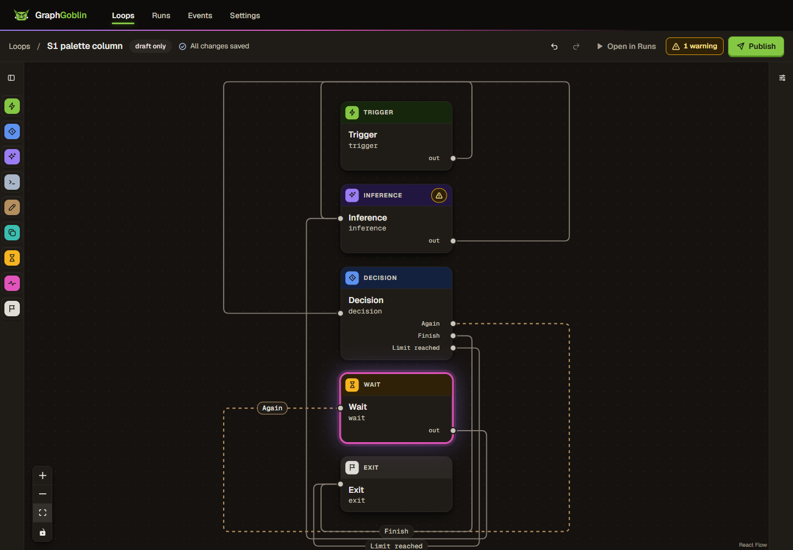 no card or label overlap         | 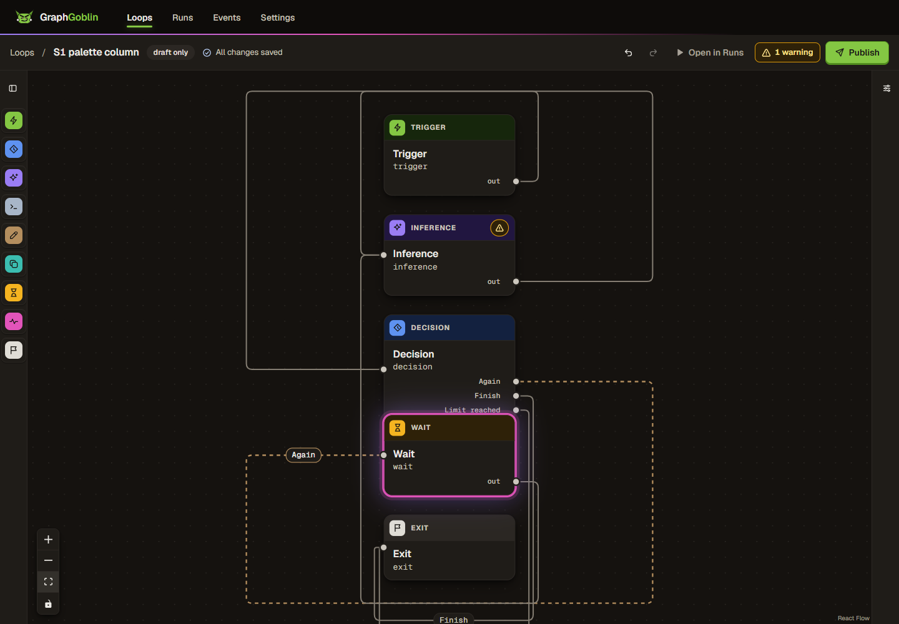 Decision on Wait |
| S2: the F2 record's own order                 | 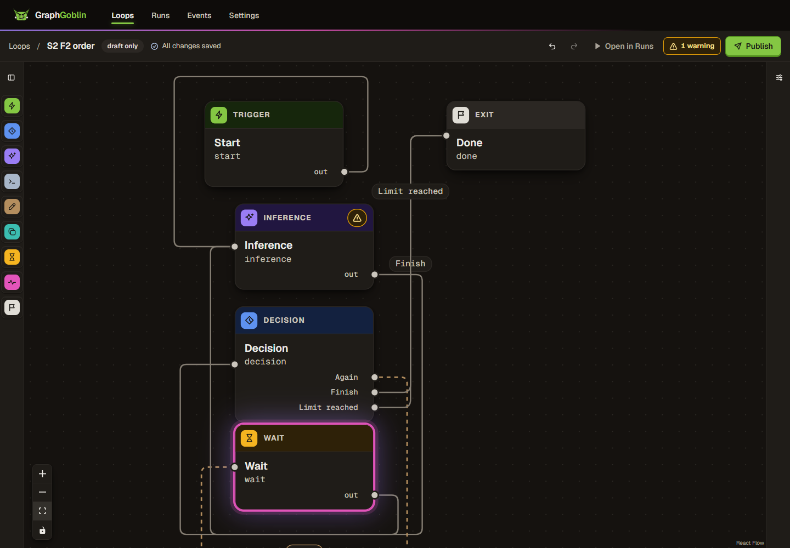 `Limit reached` moved up its own trunk | 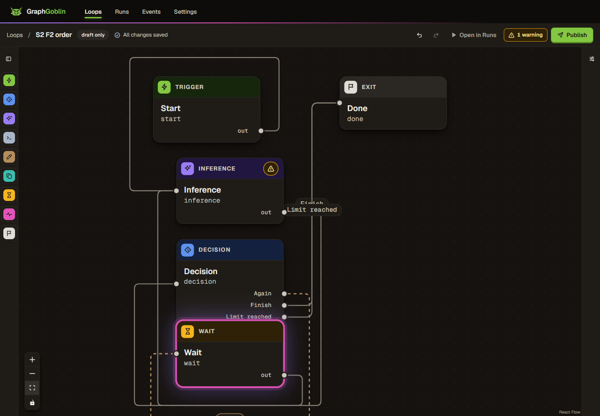 labels overlap         |
| S7: `Finish` selected                         |  label centre moved 0 px         | 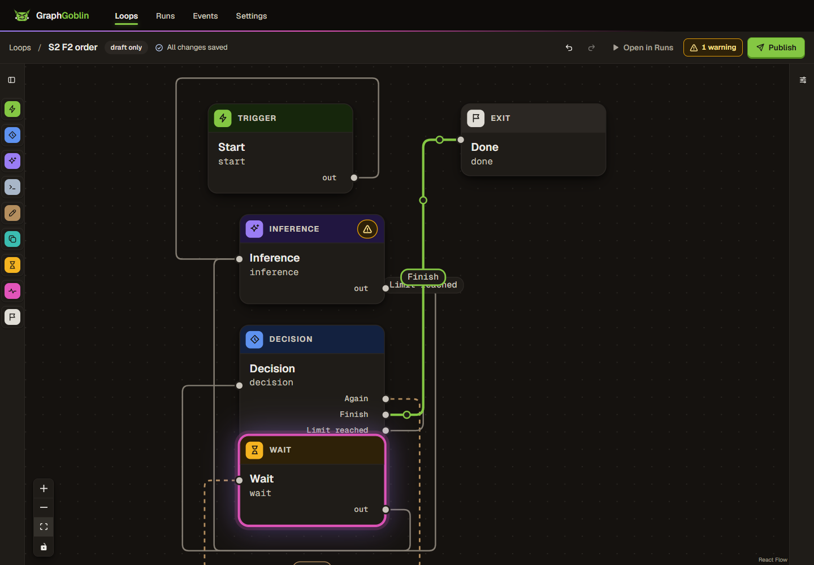                 |
| S3: manual route on `Finish`                  | 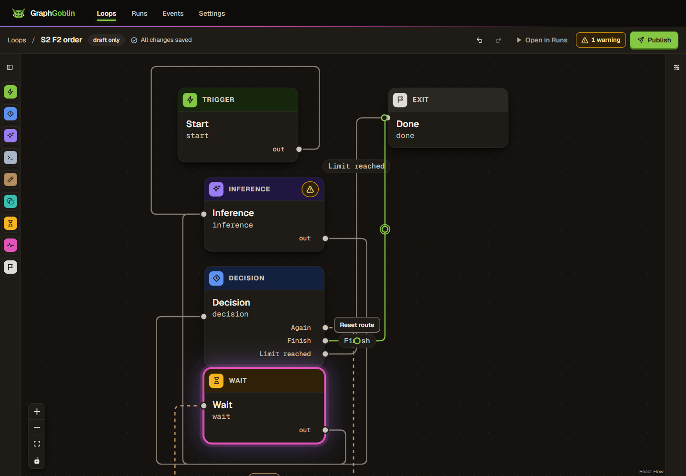                           | 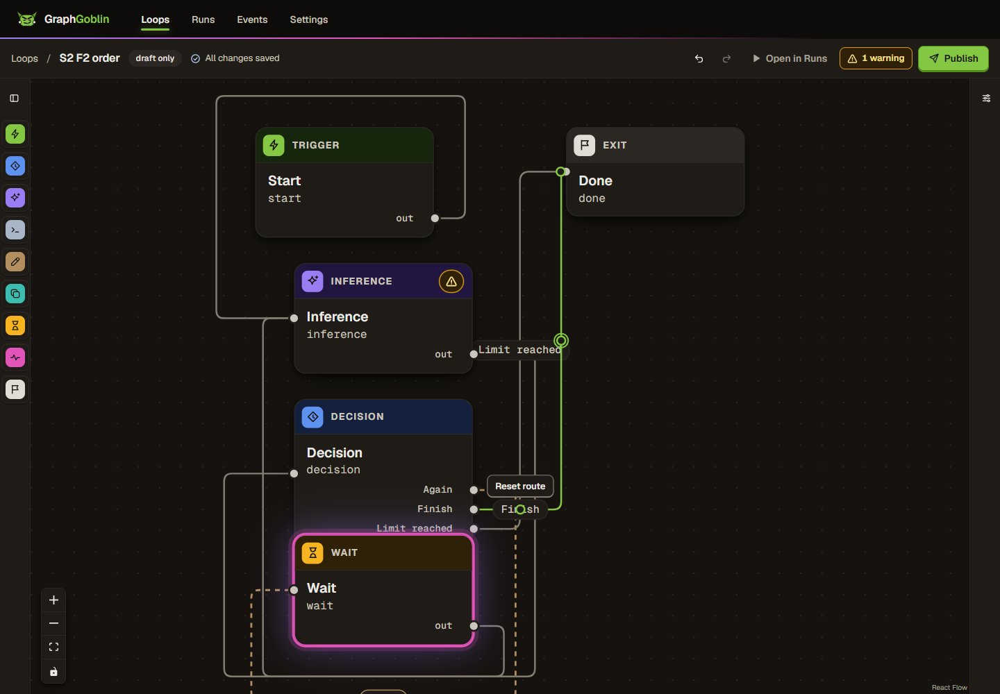           |
| S10: after dragging `Done` ±64 px in 64 steps | 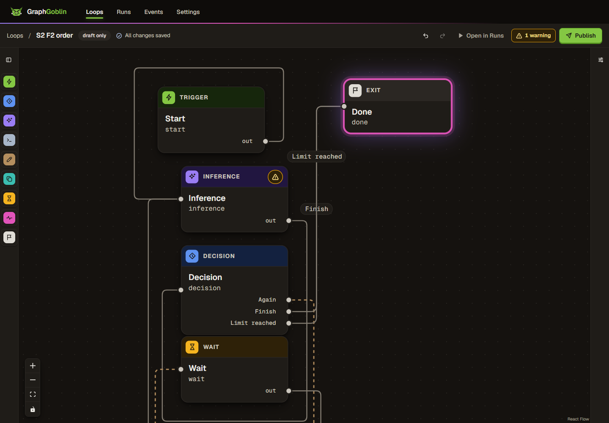                                    | 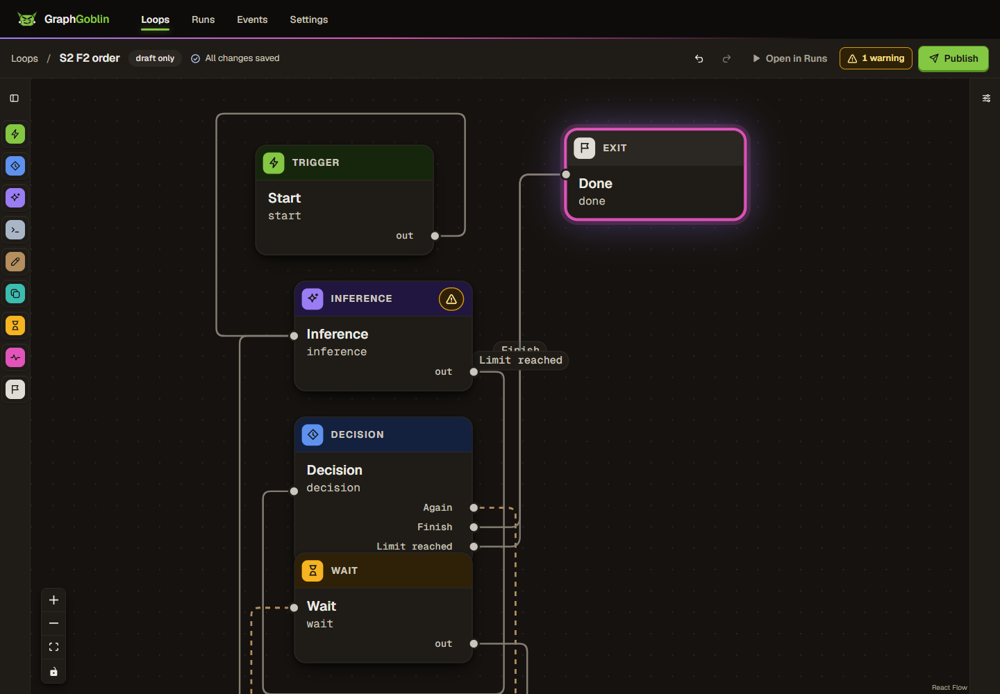                    |
| S4: 43-character label                        | 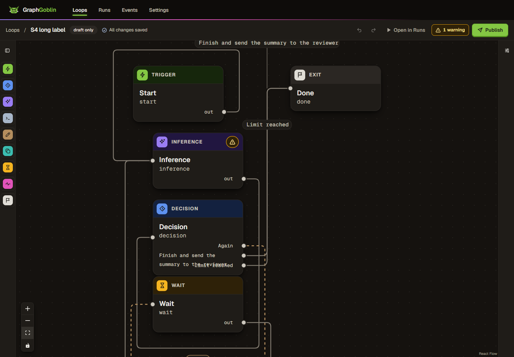 callout, 92 px leader                | 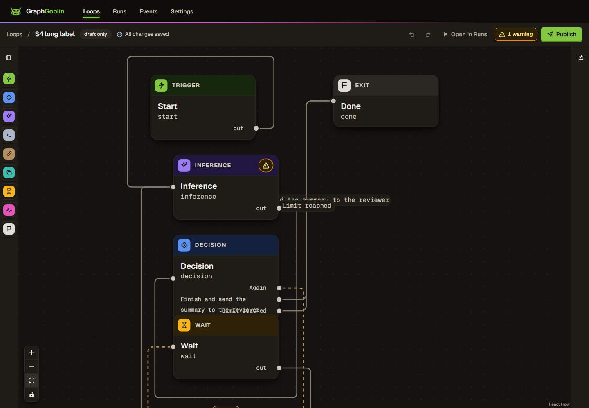                      |
| S5: short edge between adjacent cards         |  callout, 36 px leader           | 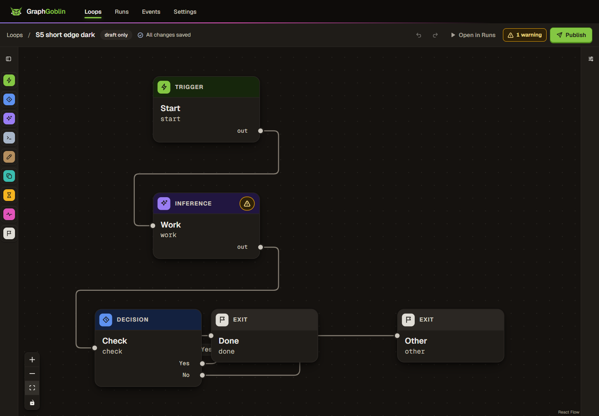                 |
| S8: path wholly under a card                  |  default label, no leader           | 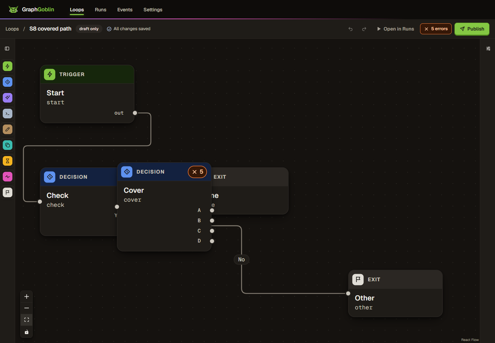                    |
| S11: 300 cards after a drag (finding 1)       |                           | 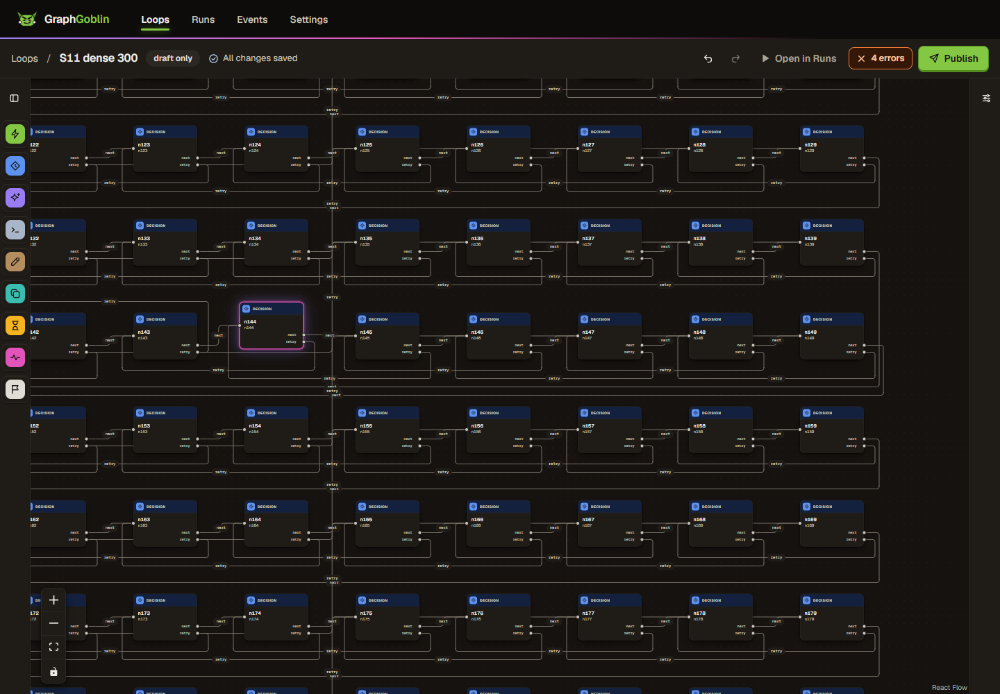          |

Other views: [S3 deselected](review-2/head-s3-manual-route.png), [S5 light](review-2/head-s5-short-edge-light.png), [S5 forced colours](review-2/head-s5-short-edge-forced-colors.png), [S5 zoom](review-2/head-s5-callout-zoom.png), [S5b](review-2/head-s5b-short-edge-long-label.png), [S12 mid-drag](review-2/head-s12-mid-drag.png), [S12 after](review-2/head-s12-after-drag.png); main's S5b and S12 captures are beside them.

## Method and environment

- **Main baseline web build.** [tools/main.vite.config.mjs](review-2/tools/main.vite.config.mjs) builds `apps/web` with `a4fee9a9`'s version of every changed runtime module that exists on main, read with `git show`. It wrote to `%TEMP%\gg-rev425b-main-dist`. The JavaScript hash equals scan 1's baseline. The Edge runs pointed the e2e server at it through `GG_E2E_WEB_DIST`.
- **Edge runs.** [tools/run-e2e.ps1](review-2/tools/run-e2e.ps1) strips `GG_*` and `JEV_API_KEY`, then sets:
  - `GG_TEST_PORT_START=7500`, `GG_TEST_PORT_COUNT=40`;
  - `GG_TEST_DATA_PREFIX=gg-rev425b-`;
  - `GG_E2E_BROWSER_CHANNEL=msedge`;
  - Playwright output under `%TEMP%\gg-rev425b-pw-*`, and performance reports under `%TEMP%\gg-rev425b-reports`.
- **Main's unmodified specs.** `loop-lifecycle.spec.ts` and `responsive.spec.ts` at `a4fee9a9` ran from two temporary untracked files in `apps/web/e2e/` (`rev425b-main-*.spec.ts`), which were removed afterwards. The `@graphgoblin/web` lint run happened while they existed; they are main's own files.
- **Scenario numbering.** The behaviour script's S9 to S12 checks are new to this scan; S1 to S7 follow scan 1's numbering.
- **Evidence handling.** [tools/sanitize.mjs](review-2/tools/sanitize.mjs) rewrote every text file in `review-2/` as UTF-8 without BOM, with the profile path, user name, machine name and SIDs redacted. Every retained file is under 1,000,000 bytes. Playwright traces of the failures stay under `%TEMP%\gg-rev425b-pw-*` and are not kept.
- **Allocations.** Ports 6350 and 6351 for the reviewer gateways; e2e servers on ephemeral loopback ports; temp prefix `gg-rev425b-`.
- **Isolation.** The owner's instance (4747/4748), `~/.graphgoblin`, the main checkout and other worktrees were not touched. Every gateway I started was drained through `/system/shutdown` and exited 0.
- **Not removed.** Disposable stores, Playwright outputs, reports and the baseline build under `%TEMP%\gg-rev425b-*`, and the ignored `apps/web/coverage` output in the reviewer worktree.
