CHANGES REQUIRED: WP-425 at 894f4197a0d5e94575d75614ad4c3186cdc43449 may not merge yet (findings 1 to 3).

# Independent review of WP-425 (issue #425): palette placement and edge-label separation

- **Reviewed commit:** `894f4197a0d5e94575d75614ad4c3186cdc43449` (branch `codex-wp-425-placement`, one commit on `main` `a4fee9a9`), checked out detached in a separate reviewer worktree. Diff reviewed: `git diff a4fee9a9 HEAD`.
- **Reviewer:** independent reviewer; I did not write this change. No product code or test was changed and nothing was committed. Scratch copies used for measurement (listed under "Method") were outside the tracked tree or removed afterwards.
- **Runtime:** Node v22.23.4 at `%USERPROFILE%\.claude\codex-runs\GraphGoblin\runtime\node-v22.23.4-win-x64\node.exe`, pnpm 12.8.1, Microsoft Edge 156.0.4314.50 (Playwright channel `msedge`, headless). `pnpm install --frozen-lockfile` and `pnpm build` passed ([install](review/logs/install.log.txt), [build](review/logs/build.log.txt)).
- **Real provider turns:** 0. Every gateway and test environment had every `GG_*` variable and `JEV_API_KEY` removed; the reviewer gateways pointed `GG_CODEX_BINARY` and `GG_CLAUDE_BINARY` at files that do not exist, and no run was started.

## Findings

### 1. P1: label placement makes dragging on large graphs about three times slower

`Canvas.tsx` recomputes `placeEdgeLabels` for every labelled edge whenever `plan.nodes` or `routes` change, which is every drag frame. Each label rebuilds and re-expands the whole obstacle list (all cards plus every label placed before it, `expand()` allocating a new box each time) and filters it per segment, so one call is O(labels × (cards + labels)) with fresh allocations.

- **Node benchmark** on the routing fixtures, the same inputs `Canvas.tsx` builds ([script](review/tools/label-bench.mts), runs [1](review/logs/label-bench-1.log.txt) and [2](review/logs/label-bench-2.log.txt)). `denseGraph(300)` (599 labelled edges): label placement **30.0 to 32.1 ms p50, 41.8 to 45.9 ms p95 per drag step**, against the router's 3.0 ms p50 and 4.3 to 4.7 ms p95 for the same step. `denseGraph(100)`: 3.8 to 4.9 ms p50, 5.5 to 10.8 ms p95, already above the router's 4 ms strict budget.
- **Edge, `routing.spec.ts` "performance: 300 nodes / 600 edges", the same input on both builds.**
  - Main: the page handled 266 to 279 of about 306 pointer moves per five-second drag, with 224 to 240 routing updates and input acknowledgement p95 29 to 33 ms.
  - Branch: it handled 93 to 100 pointer moves, with 85 to 90 routing updates and acknowledgement p95 71 to 121 ms ([branch](review/logs/edge-branch-editor.log.txt), [main](review/logs/edge-main-routing.log.txt)).
- **CPU profile of that drag** ([summary branch](review/logs/profile-branch.log.txt), [summary main](review/logs/profile-main.log.txt), raw profiles kept as `review/logs/drag-300-*.cpuprofile`). On the branch, `edge-label-placement.ts` takes 29.3 % of self time, `routing-geometry.ts` `expand` 8.5 % (called from it) and garbage collection 8.5 %. The main thread is idle 4.1 % of the time, against 41.7 % on main.
- **The repository's gate would not catch this.** The `gg:backward-routing` measure the performance test asserts on stops before label placement. Frame p95 is enforced only in strict mode (`GG_ROUTING_STRICT_PERF=1`).
- On this host both builds fail that test's `frameSamples > 120` the same way, because headless Edge drew at about 10.7 Hz even when idle (idle frame p95 93 ms on both). So the frame numbers here say nothing either way; the pointer-move, routing-update, acknowledgement and profile numbers above do.
- **Required:** bring label placement within the drag budget on the 300-card fixture. For example: index obstacles (a `BoxIndex` like the router's), update only labels whose geometry or neighbourhood changed, or hold placements during a drag and settle on drop. Then add a deterministic work-count or timing guard for it, as `routing-manual.test.ts` has for the router.

### 2. P1: three existing editor browser tests fail; the change silently redefines two documented behaviours

`e2e/routing.spec.ts` fails three tests on the branch: 6 of 6 failed with `--repeat-each=2`. The same tests pass 6 of 6 on main's build ([branch](review/logs/edge-routing-rerun-branch.log.txt), [main](review/logs/edge-routing-rerun-main.log.txt), first run [here](review/logs/edge-branch-editor.log.txt)). The record's browser gate ran only `palette-placement`, `palette` and `edge-routes`.

- **`dark:` and `light: six-return-decision routes and labels, owner screenshot`**
  - Failure: `expect(.react-flow__edge-orthogonal).toHaveCount(6)` received 7.
  - Cause: every labelled forward edge (here `finish`) is now type `orthogonal`.
  - Docs not updated: `docs/09-frontend-and-pwa.md` still says "Forward edges retain xyflow's existing `smoothstep` paths (the orthogonal edge draws the same path while one is selected)" (line 48) and "Forward edges use xyflow's built-in `smoothstep` path" (line 140).
- **`vertical targets, long script route, overlapping cards and zoom`**
  - Failure: the script route's pill no longer ends in `…`.
  - Cause: `OrthogonalEdge.tsx` sets `visibleLabel = fullLabel` whenever a placed label exists. That drops the router's lane-fit truncation ("Fit text on the straight segment; the edge's accessible name and title keep the full port") for every routed edge, not only colliding ones.
  - Side effect: placed labels are wider than the router reserved and may move off the reserved region, so automatic routes are planned around a label position that is no longer drawn.
- **Required:** either keep these behaviours, or change them deliberately. A deliberate change updates the two tests, `docs/09` lines 48 and 140, and the comments in `Canvas.tsx` (`buildEdges` header) and `OrthogonalEdge.tsx`, and states in the CHANGELOG that routed labels are no longer shortened. Then run `routing.spec.ts` with the other editor specs.

### 3. P2: the fallback callout is placed above the whole graph, far from its edge

When no segment has room, `placeEdgeLabels` puts the label at `y = min(preferred.y, top of every obstacle on the canvas) - 26` and draws a straight leader to the nearest point of the edge. That is the top of the entire graph, not a free place near the edge. Further fallbacks stack above it.

- **S5, a short edge between adjacent cards** ([dark](review/branch-s5-short-edge-dark.png), [light](review/branch-s5-short-edge-light.png), [forced colours](review/branch-s5-short-edge-forced-colors.png)).
  - The `Yes` label of `check → done` sits above the Trigger card, 666 screen px from its own path, with a 699 px leader.
  - The leader runs through the `start` and `work` cards: hidden behind them in the normal themes, and visibly through them in forced colours.
  - The pill reads as a label of the Trigger's own edge.
  - On main the same pill was hidden under the Done card ([main](review/main-s5-short-edge-dark.png)). The branch makes it visible but detached.
- **S4, a 43-character route label** ([branch](review/branch-s4-long-label.png)).
  - The pill lands on the top lane of the unrelated `start → inference` return route, 105 px from its own path.
  - Its 339 px leader coincides with the shared Finish/Limit reached trunk.
- `docs/09` promises "a leader attaches a clear callout to the nearest point of that edge". The anchor is the nearest point, but the callout is not near it.
- The unit test for this path (`avoids cards and falls back…`) has one card and no other edges.
- **Required:** search for the nearest free position around the anchor first, keep clear of other edges' lanes as well as cards and labels, and bound the leader length. Cover a fallback under other cards with a test.

### 4. P3: documentation and record accuracy

- `docs/09` lines 48 and 140, and the `buildEdges` comment in `Canvas.tsx` ("Unselected forward edges without a manual route keep xyflow's smoothstep path"), are stale; see finding 2.
- `docs/09`'s new paragraph says placement uses "the current port count's card footprint when a measurement is pending". The code always takes the larger of the measurement and the footprint. The behaviour is right and the wording is narrower than it.
- The record `README.md` still says "Uncommitted" and names the implementer's worktree. The change is now commit `894f4197`.
- The record's red-before numbers (8 failed, 1 passed) are from an earlier nine-test version. Against main's behaviour, today's 12 tests give **11 failed, 1 passed** ([log](review/logs/unit-red-before.log.txt)); the passing one is "keeps an isolated label in place and omits empty labels".
- `unit-before.log.txt` carries 41 `System.Management.Automation.RemoteException` lines: PowerShell 5.1's stderr wrapping, which AGENTS.md warns about.

## Observations (no change required)

- **`edge-routes.spec.ts` synchronisation changes are legitimate.**
  - Main's own unmodified spec, run three times against each build, fails "a node move keeps the manual detour if resetting would cross the original obstacle" 3 of 3 times on **both** main and the branch on this host ([main build](review/logs/edge-mainspec-main.log.txt), [branch build](review/logs/edge-mainspec-branch.log.txt)). The new viewport-settle wait fixes a pre-existing failure; it does not hide a regression.
  - The keyboard test passed 3 of 3 times on both builds without the new `page.clock.setFixedTime`, so freezing `Date.now` is not needed here. It makes the "one undo step" assertion independent of timing; acceptable, but it is a test-semantics change outside the brief's files.
- **F2's own order still leaves no clearance.** In F2's original authoring order the Wait is added before the Decision grows (S2). The Wait then lands 156 px under the two-output Decision's top and ends **2 px** below the grown three-output card: no overlap, but no clearance. A fourth output would overlap again. This is what option A (no re-layout) implies; the owner may want to know.
- **Outside scope, pre-existing on main.** A long route label wraps inside the Decision card's 18 px port row and overprints the next row ("Finish and send the summary to the reviewer" over "Limit reached", S4). On a manually routed edge whose pill sits on a short stub, the stub's handle is drawn on the pill (S3); main draws it the same way.

## What I checked

### 1. Placement (`node-placement.ts`, `nodeCardHeight`, `Palette.tsx`)

- **Footprint formula against NodeCard.** `92 + (ports ? 2 + 20 × ports : 0)` matches the classes: 1 px borders, `h-9` header, `pt-2`/`pb-2.5`, `leading-5` label, `leading-4` id, `mt-1` port list, `h-[18px]` rows with `gap-0.5`.
- **Measured in Edge on the built API** ([script](review/rev425-card-heights.mjs), [log](review/branch-card-heights.log.txt), [screenshot](review/branch-card-heights.png)). Rendered heights equal the footprint exactly for:
  - every one-port kind (Trigger, Inference, Mutate, Subloop, Wait, Heartbeat): 114 px
  - Exit: 92 px
  - Script with two exit-code routes: 154 px
  - Decisions with two outputs: 134 px
  - Decisions with three outputs, including Limit reached: 154 px
  - Decisions with six outputs: 214 px
- **Stale measurement.** Growing a gate to four outputs in its dialog and pressing **Add Exit node** immediately, with no wait for xyflow's measurement, placed the exit at y = 796 = 600 + 174 + 22. No existing card moved.
- **Behaviour.** `palettePosition` takes the larger of the DOM measurement and the footprint, so a stale smaller measurement cannot win. It uses the lowest bottom, not the lowest top. The pan to the new card is kept: the S1 Wait and Exit were inside the canvas after their presses.
- **Drag from the palette is unchanged.** The drop path in `Canvas.tsx` is untouched and `palette.spec.ts`'s drag test passes.

### 2. Labels (`edge-label-placement.ts`, `Canvas.tsx`, `OrthogonalEdge.tsx`, `route-channels.ts`, `canvas-routes.css`)

- **Overlaps, through the real API in Edge.** On the branch no two label pills intersect, no pill sits on a card, and every label without a leader is within 0.7 px of its own path in S1, S2, S3, S4 and S7. On main the same scenarios reproduce issue #425: in S2 Finish overlaps Limit reached and Limit reached sits on the Inference card. See "Behaviour" below.
- **Selection.** Selecting the labelled forward `finish` edge moved its pill by 0 px and showed three segment handles (S7). The edge is `orthogonal` before and after selection, so the type no longer flips on select.
- **Manual routes.** Dragging that edge's vertical stored `route: [316]` and gave the accessible name "decision Finish (finish) to done, manual route". Labels stayed separate, selected and deselected (S3).
- **Flicker and churn.**
  - While the Decision was dragged in 16 steps, every sampled frame kept every label within 0.7 px of its path, with no overlaps (S6). On main, labels drifted up to 16.5 px from their paths in some frames.
  - DOM mutations on edges not attached to the dragged card: 2 on the branch and 2 on main.
  - `route-channels.ts` compares `at`, `box` and `anchor` before waking an edge; the unit test covers the equal-value case.
  - On large graphs the cost is finding 1.
- **Accessibility.** The full text is in each labelled edge's `<title>` and in its pill. Placed labels are never truncated; that is the behaviour change in finding 2.
- **Leader line, as computed in Edge.**
  - Light theme: `rgb(132,125,114)` on `rgb(251,250,248)`, 3.90:1.
  - Dark theme: the same stroke on `rgb(21,18,15)`, 4.58:1.
  - Forced colours: black on white (`CanvasText` through the edge's `forced-color-adjust: none`), 21:1.
  - It is 1 px wide and keeps the unselected stroke when its edge is selected.

### 3. Scope

- No stored definition changes besides the new node's `ui`: S1 and the card-height check show no existing node moved after any press.
- Label positions are view-only.
- No re-layout, schema, API or dependency change.
- The `edge-routes.spec.ts` edits are outside the brief's file list; see Observations.

### 4. Tests

- **Unit, red before** ([log](review/logs/unit-red-before.log.txt)). The branch's `node-placement.test.ts` and `edge-label-placement.test.ts` were run unchanged, from a scratch folder (since removed), twice:
  - against the branch modules: 12 of 12 pass;
  - against shims reproducing main's behaviour (`{x: 40, y: max(ui.y) + 140}`, and each label at its own preferred point): 11 failed, 1 passed.
- **`pnpm test:coverage --filter @graphgoblin/web`** (cache miss, [log](review/logs/coverage.log.txt)): 155 files and 1832 tests passed.
  - Lines 98.94 % (8176/8263)
  - Branches 94.81 % (8682/9157)
  - Statements 98.1 % (9368/9549)
  - Functions 98.11 % (2505/2553)
- **Static checks:**
  - `pnpm --filter @graphgoblin/web typecheck` and `lint`: pass ([typecheck](review/logs/web-typecheck.log.txt), [lint](review/logs/web-lint.log.txt)).
  - `prettier --check` on the changed files: pass ([log](review/logs/format-check.log.txt)).
- **Edge specs on the branch build:**
  - `palette-placement`, `palette`, `edge-routes`, `decision-routes`, `undo`, `routing`: **59 passed, 5 failed** ([log](review/logs/edge-branch-editor.log.txt)). The failures are the three `routing.spec.ts` regressions (finding 2) and the two performance tests.
  - The two performance tests fail identically on main's build on this host (frame sampler at about 10.7 Hz); main's full `routing.spec.ts` gave 21 passed, 2 failed ([log](review/logs/edge-main-routing.log.txt)).
  - `responsive`, `qa`, `loop-lifecycle`, `drafts`, `device-first`, `node-placement`: **54 passed** ([log](review/logs/edge-branch-editor-2.log.txt)).

### 5. Behaviour through the built product in Edge (reviewer-run)

- **Setup** ([script](review/rev425-behaviour.mjs)). The built API (`apps/api/dist/main.js`) ran on a disposable store under `%TEMP%\gg-rev425-store-*`: port 6350 serving the branch's `apps/web/dist`, then port 6351 serving a main-baseline web build. Headless Edge, 1440 × 1000, Fit View with both panels hidden.
- **Results:** branch **54 checks passed, 0 failed** ([log](review/branch-behaviour.log.txt), [result](review/branch-behaviour-result.json)); main 27 passed, 27 failed ([log](review/main-behaviour.log.txt), [result](review/main-behaviour-result.json)). On main, the failures are issue #425's overlaps, plus `<title>` checks that main's built-in smoothstep edges do not render.

| Scenario                                                                                                                                                                                    | Branch                                                                                    | Main (baseline)                                                                                     |
| ------------------------------------------------------------------------------------------------------------------------------------------------------------------------------------------- | ----------------------------------------------------------------------------------------- | --------------------------------------------------------------------------------------------------- |
| S1: the brief's order by palette presses only (Trigger, Inference, Decision → Again/Finish + Limit reached, Wait, Exit; six connections; no card dragged). Stored y: 40, 176, 312, 488, 624 | 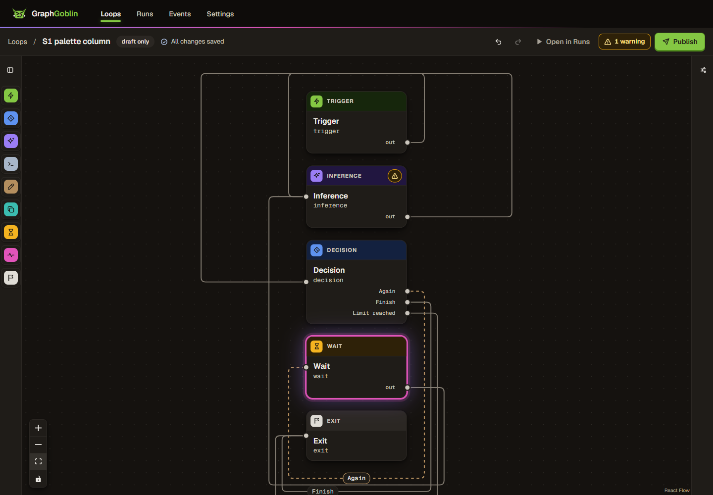 no card or label overlap                | 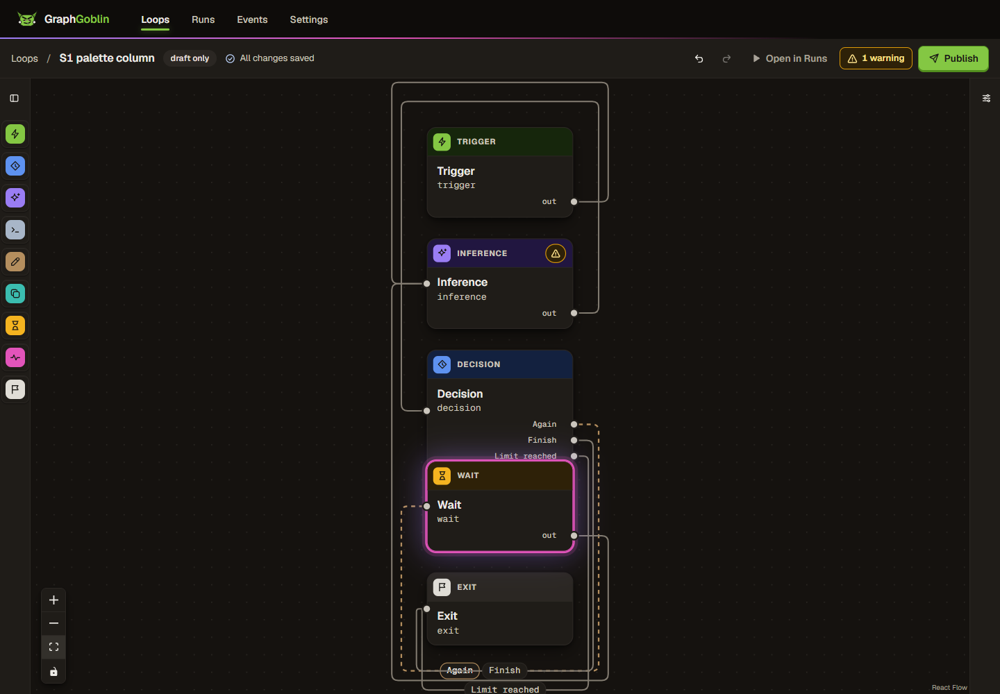 Decision / Wait overlap                               |
| S2: F2 record's own order (starter graph kept, Wait added before the Decision grew)                                                                                                         | 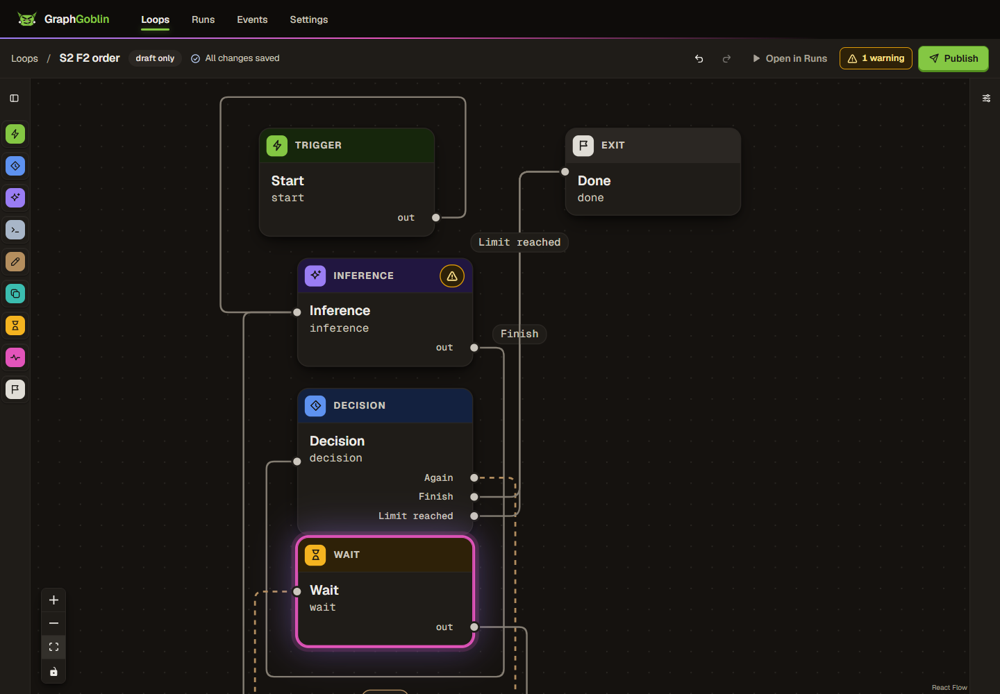 separated; Wait 2 px under the grown Decision | 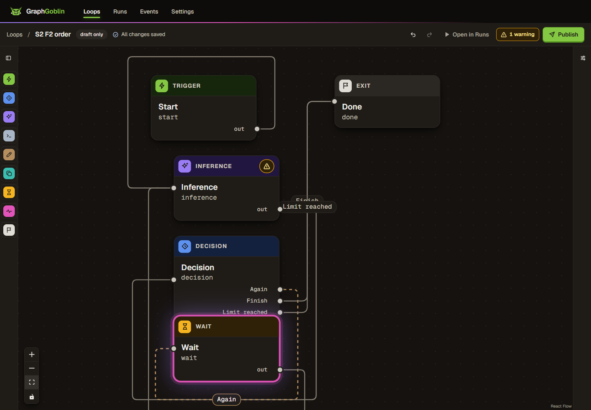 O3 reproduced: Wait on Decision, Finish under Limit reached |
| S7: labelled forward edge selected                                                                                                                                                          |                                         | 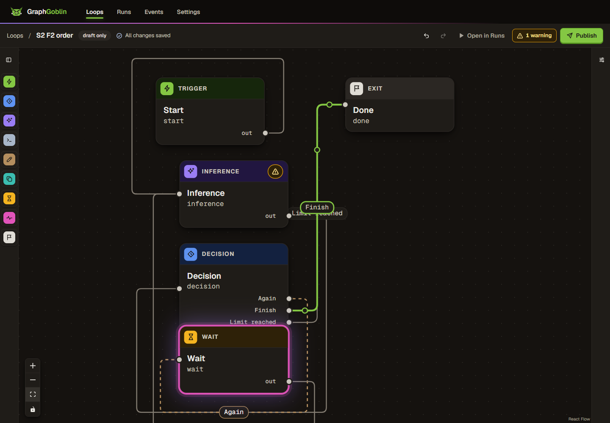                                                      |
| S3: manual route on the labelled forward edge                                                                                                                                               | 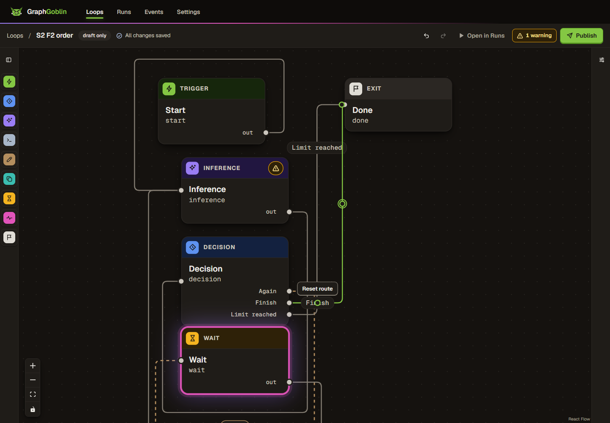                                  | 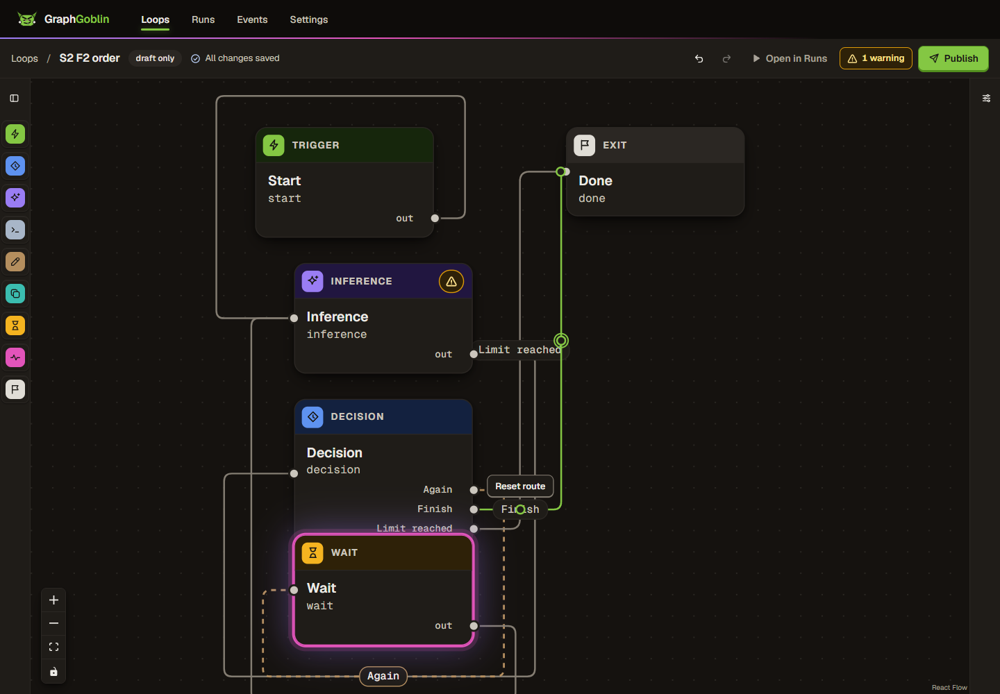                                                |
| S6: after dragging the Decision right in 16 steps                                                                                                                                           | 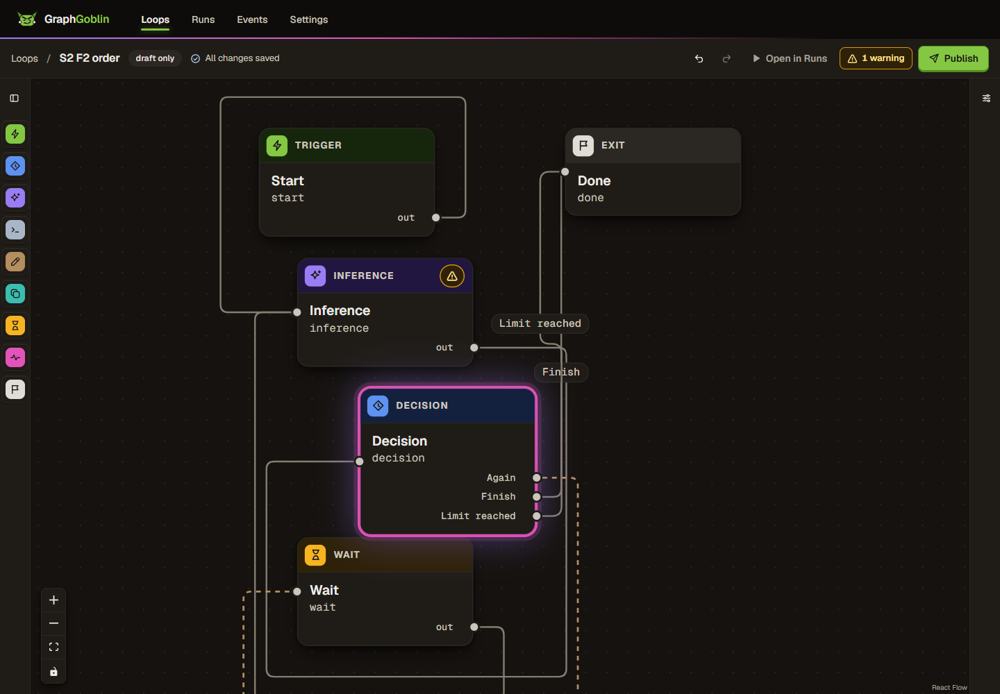                                             | 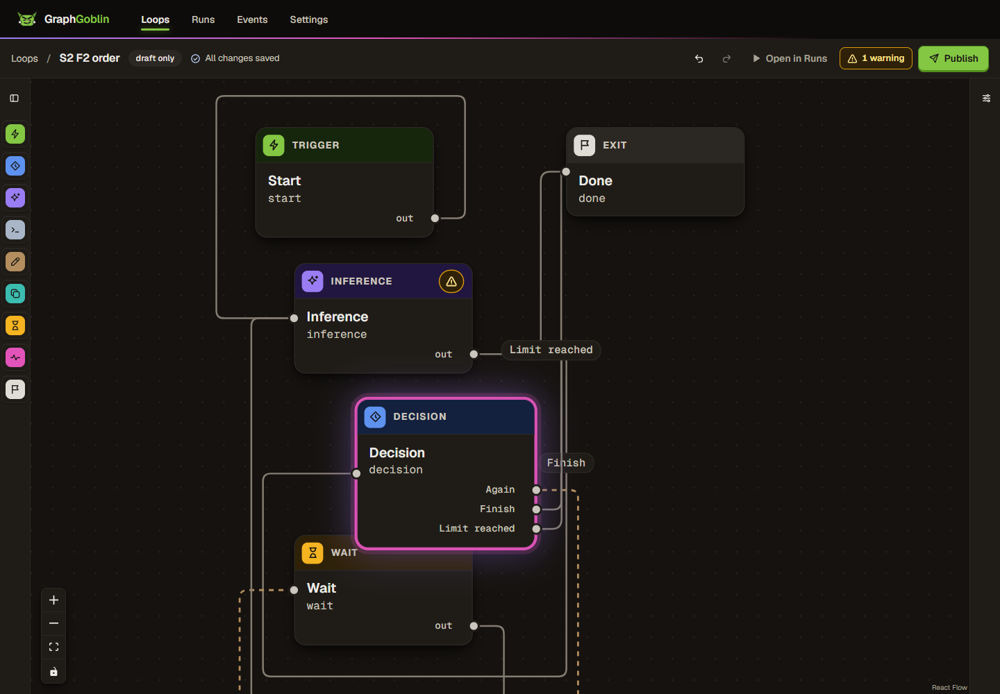                                                           |
| S4: long route label                                                                                                                                                                        | 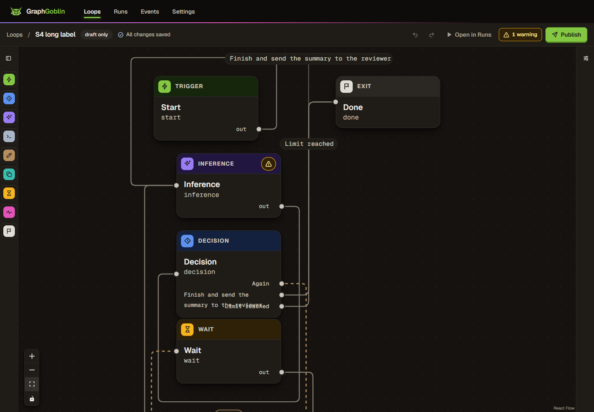 callout on another edge's lane (finding 3)  | 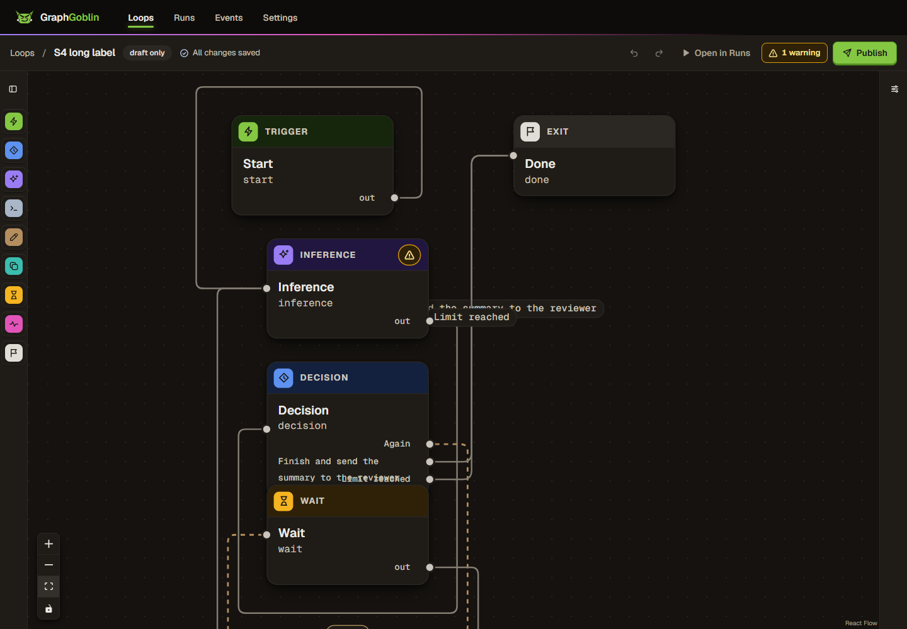                                                           |
| S5: very short edge between adjacent cards                                                                                                                                                  |  callout above the graph (finding 3)    |  pill hidden under Done                               |

Close-ups: [S1 branch](review/branch-s1-labels.png), [S2 branch](review/branch-s2-labels.png), [S2 main](review/main-s2-labels.png). Other views: [S3 deselected](review/branch-s3-manual-route.png), [S5 light](review/branch-s5-short-edge-light.png), [S5 forced colours](review/branch-s5-short-edge-forced-colors.png).

## Method and environment

- **Main baseline web build.** [tools/main.vite.config.mjs](review/tools/main.vite.config.mjs) builds `apps/web` with `a4fee9a9`'s versions of the six changed runtime modules, read with `git show`, into `%TEMP%\gg-rev425-main-dist` ([log](review/logs/build-main-baseline.log.txt)).
  - Its JavaScript bundle hash (`index-Db3Klbv7.js`) equals the implementer's baseline build.
  - The CSS bundle includes the unused `.gg-edge-label-leader` rule, because Tailwind reads `canvas-routes.css` directly.
  - Edge specs ran against it through the e2e server's `GG_E2E_WEB_DIST`.
- **Main's unmodified `edge-routes.spec.ts`** ([copy](review/tools/main-edge-routes.spec.ts)) ran from a temporary untracked file in `apps/web/e2e/`, removed afterwards.
- **Profiles.** [tools/profile-summary.mjs](review/tools/profile-summary.mjs) maps the CPU profiles through each bundle's source map.
- **Evidence handling.** [tools/sanitize.mjs](review/tools/sanitize.mjs) copied every log into the record as UTF-8 without BOM, with the profile path, user name, machine name and SIDs redacted. Every retained file is under 1,000,000 bytes; the two CPU profiles are 704,503 and 683,546 bytes.
- **Allocations.** Ports 6350 to 6352. `GG_TEST_PORT_START=7500`, `GG_TEST_PORT_COUNT=40`, temp prefix `gg-rev425-`. Playwright output went to `%TEMP%\gg-rev425-pw-*`.
- **Isolation.** The owner's instance (4747/4748), `~/.graphgoblin`, the main checkout and other worktrees were not touched. Every gateway I started was drained through `/system/shutdown` and exited 0.
- **Not removed.** Disposable stores and outputs under `%TEMP%\gg-rev425-*` are left for removal.
