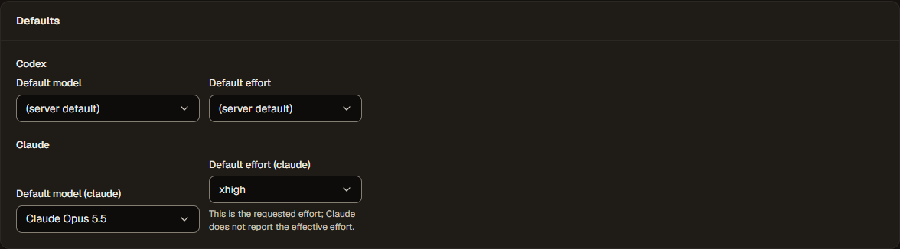
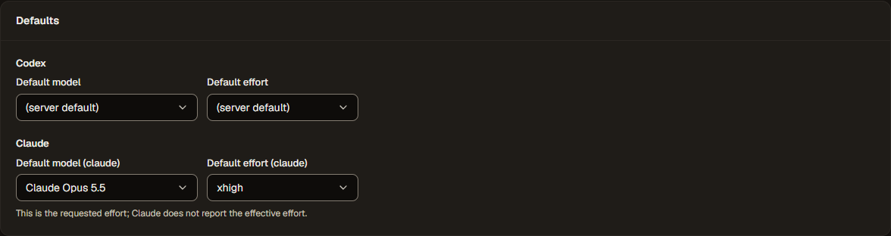

# #441: inference Prompt and Session on Context, and Settings Defaults alignment

Branch `codex/gg-20261107-context`, base `bb8c4afa0c5a83ae92631d5df800bb131445c02b`, isolated worktree `%USERPROFILE%\.codex\worktrees\gg-20261107-context\GraphGoblin`. Changes are uncommitted for the orchestrator's review. Specification: the settled Inference Context redesign of 2026-11-07 (`graphgoblin-qa/2026-10-31/agent-run/context-redesign/spec.md`, outside the repository).

## Environment

- Node `v22.23.4` (project runtime first on `PATH`), pnpm `12.8.1`, `pnpm install --frozen-lockfile` in this worktree only.
- Browser checks: the repository Playwright harness (`apps/web/e2e/server.ts`) with installed Microsoft Edge (`msedge` channel, the Windows default), `LIVE=0`. The server is the built API and web app over an in-memory database with fake Codex and Claude harnesses on ephemeral loopback ports and temporary data directories. No owner service or store, no live provider call, no secret.
- Turbo 2.11 shares a git worktree's cache with the main checkout's `.turbo/cache`. The first `pnpm build` here replayed 11 cache hits from it (reads only). Every later Turbo command set `TURBO_CACHE_DIR` to this worktree's `.turbo/cache` (gitignored), and `pnpm build --force` rebuilt every output from this worktree's sources.

## Behaviour

- Inference **Context** shows **Prompt**, **Session**, **Input**, then **Advanced → Files**. Prompt and Session each have one editor, outside Advanced. Settings keeps harness, model, effort and sandbox, with Harness options, Output and Limits under Advanced. Other node kinds are unchanged.
- The contracts tag `prompt` and `session` with `context: true`; the node editor's inference `fieldOrder` (`prompt`, `session`, `input`, `contextFiles`) now orders Context as well as Settings, because the schema declares `session` first. JSON paths, values, defaults and parsing are unchanged.
- Session keeps its heading. Its native select is **Conversation**, with the stored values and order and display labels **Start fresh**, **Resume latest in this run**, **Resume named conversation** and **Resume this node's conversation**. The Session description sits under the heading; the chosen option's help and, for resume options, the unresumable-conversation note sit under the select. All describe the select. **Conversation name** (named) and **Reset after visits** (own) appear only with their option, with the specification's help.
- The picker opts in to drawing the union's help itself (`drawsHelp`); the union field keeps the variant change, review, undo, held-text handling and conditional fields.
- Settings → Defaults: the Claude effort note moves below the model/effort row (keeping `id="default-effort-claude-help"` and the select's description), so both selects share a top edge.

## Screenshots

Dark theme (the app default), reduced motion. Source: [context-review.capture.ts](context-review.capture.ts); figures in [measurements.json](screens/measurements.json).

| View                                     | 1440 × 900                                                                         | 390 × 844                                                                      |
| ---------------------------------------- | ---------------------------------------------------------------------------------- | ------------------------------------------------------------------------------ |
| Settings tab: no Prompt or Session       | [settings-tab-desktop-1440](screens/settings-tab-desktop-1440.png)                 | [settings-tab-narrow-390](screens/settings-tab-narrow-390.png)                 |
| Context, Start fresh                     | [context-fresh-desktop-1440](screens/context-fresh-desktop-1440.png)               | [context-fresh-narrow-390](screens/context-fresh-narrow-390.png)               |
| Context, Resume named conversation       | [context-resume-named-desktop-1440](screens/context-resume-named-desktop-1440.png) | [context-resume-named-narrow-390](screens/context-resume-named-narrow-390.png) |
| Context, Resume this node's conversation | [context-resume-own-desktop-1440](screens/context-resume-own-desktop-1440.png)     | [context-resume-own-narrow-390](screens/context-resume-own-narrow-390.png)     |
| Settings → Defaults                      | [defaults-desktop-1440](screens/defaults-desktop-1440.png)                         | [defaults-narrow-390](screens/defaults-narrow-390.png)                         |

For each of the four policies at both widths, `measurements.json` records Context order `prompt, session, input, contextFiles`, Prompt and Session visible with Context's Advanced collapsed, the selected label, the select's description texts (section, option help, and the note for resume options), exactly one conditional field for named/own and none otherwise, the select inside the dialog, and `scrollWidth` equal to the viewport width. Native option lists are drawn by the operating system and are not captured; the longest label, "Resume this node's conversation", is fully visible in the closed select at 390 px.

## Defaults alignment, red before

The Defaults change was reverted in the working tree, the web app rebuilt, and the new browser test run; then the change was restored, rebuilt and run again.

| Before (baseline layout)                                                                       | After                                                                  |
| ---------------------------------------------------------------------------------------------- | ---------------------------------------------------------------------- |
|  |  |

- [Before](defaults-alignment-before.log.txt): `claude` effort top 1836.47 px, model top 1874.84 px; the test fails. Figures in [before-measurements.json](screens/before-measurements.json).
- [After](defaults-alignment-after.log.txt): passes. Codex and Claude rows have equal tops and heights; the note sits below the effort select and still describes it.

## Tests

Unit (Vitest, jsdom):

- `src/forms/session-policy.test.tsx` (rewritten, real node editor dialog): Context order and single editors, Settings content, Prompt/Session outside Advanced; every policy's label, value, description, note and conditional field; a new node opens at Start fresh and viewing writes nothing; stored values load and edit exactly; autosave of a name keeps focus and tab; one undo/redo step per policy change with focus kept; template and name issues count on Context and focus their fields from Settings; reset validation.
- `src/forms/union-picker.test.tsx` (new): the `drawsHelp` opt-in and the unchanged default.
- `src/forms/layout.test.ts`: inference Settings/Context placement, display order through `contextLayout` and unions, `orderedShape`.
- Updated expectations: `advanced.test.tsx`, `context.test.tsx`, `SchemaForm.test.tsx`. `SettingsPage.test.tsx` keeps its accessible-description assertion unchanged.

Browser (Playwright, Edge): `claude-harness.spec.ts` gains the Defaults select-top test. Updated for the new placement: `own-session.spec.ts` (Conversation keyboard choice, autosave keeps focus and tab, reopen), `node-placement.spec.ts`, `forms.spec.ts`, `issue-170-qa.spec.ts` (every-field placement, session policies with undo/redo, tab order, Context counts), `node-json.spec.ts`, `template-gallery.spec.ts`, and `live.spec.ts` (LIVE=1 only; not run).

Focused results on the final source (2026-11-07):

- Web unit, whole package before the last test-type and refactor edits: 157 files, 1862 tests passed. Final rerun of `src/forms src/editor src/settings src/components`: 100 files, 1344 tests passed. Contracts: 23 files, 286 tests passed. API `guide-examples.test.ts`: 16 passed.
- `apps/web` and `packages/contracts` typecheck and lint clean; `pnpm check:docs` up to date; repository `pnpm format:check` clean.
- Browser, final run of 23 specs (claude-harness, model-picker, model-effort, own-session, node-placement, forms, issue-170-qa, node-json, template-gallery, missing-session, editor-modal, form-controls, node-harness, exit-primitives, palette-placement, qa, undo, responsive, earlier-node-outputs, validation, issue-7-qa, stored-loop-defaults, live): 213 passed, 1 skipped (`live.spec.ts`, LIVE=1 only), 20.8 min.
- An earlier browser run of 10 of those specs had 3 failures, all exact Context tab names (`Context 1 error`, `Context 1 set`) that now include the prompt in the "set" count; the assertions were updated and the three tests pass.
- Not run here: `pnpm check` (full typecheck, lint, coverage, licences and the other repository gates) and the complete browser suite; the orchestrator serializes them.

## Commands

```text
pnpm install --frozen-lockfile
TURBO_CACHE_DIR=<worktree>/.turbo/cache pnpm build --force
pnpm docs:generate                         # docs/reference/nodes.md: session description
cd apps/web
pnpm typecheck && pnpm lint
pnpm exec vitest run
LIVE=0 pnpm exec playwright test e2e/<spec>.ts ...
# capture: copy context-review.capture.ts to apps/web/e2e/, then
LIVE=0 pnpm exec playwright test -c playwright.capture.config.ts e2e/context-review.capture.ts
```
